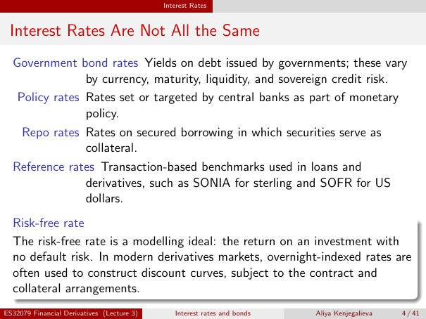

# lecture-3: physical PDF page 4

<a id="lecture-3-pdfPage-004"></a>

- Source ID: `lecture-3`
- Original: `context/lecture slides/Lecture 3 Interest rates and bonds.pdf`
- Original SHA-256: `df4aabe19a4bf757759406b1a8b4c95f4ab1656361d68456c6c2fdacf5ab047e`
- Locator: `pdfPage:4` (physical page; not printed slide numbering)
- Fidelity status: raw layout extraction; independent visual QA pending. Equations, glyphs and diagrams are not certified by extraction success.



## Uncorrected layout extraction

```text
                                            Interest Rates


 Interest Rates Are Not All the Same
  Government bond rates Yields on debt issued by governments; these vary
                by currency, maturity, liquidity, and sovereign credit risk.
   Policy rates Rates set or targeted by central banks as part of monetary
                policy.
    Repo rates Rates on secured borrowing in which securities serve as
                collateral.
  Reference rates Transaction-based benchmarks used in loans and
                derivatives, such as SONIA for sterling and SOFR for US
                dollars.
  Risk-free rate
  The risk-free rate is a modelling ideal: the return on an investment with
  no default risk. In modern derivatives markets, overnight-indexed rates are
  often used to construct discount curves, subject to the contract and
  collateral arrangements.
ES32079 Financial Derivatives (Lecture 3)      Interest rates and bonds   Aliya Kenjegalieva   4 / 41
```
