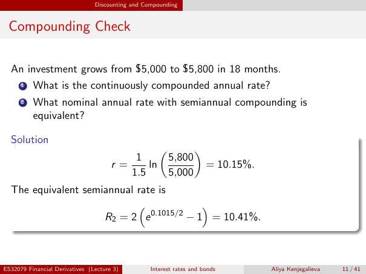

# lecture-3: physical PDF page 11

<a id="lecture-3-pdfPage-011"></a>

- Source ID: `lecture-3`
- Original: `context/lecture slides/Lecture 3 Interest rates and bonds.pdf`
- Original SHA-256: `df4aabe19a4bf757759406b1a8b4c95f4ab1656361d68456c6c2fdacf5ab047e`
- Locator: `pdfPage:11` (physical page; not printed slide numbering)
- Fidelity status: raw layout extraction; independent visual QA pending. Equations, glyphs and diagrams are not certified by extraction success.



## Uncorrected layout extraction

```text
                                Discounting and Compounding


 Compounding Check

  An investment grows from $5,000 to $5,800 in 18 months.
      1   What is the continuously compounded annual rate?
      2   What nominal annual rate with semiannual compounding is
          equivalent?

  Solution
                                                                 
                                          1              5,800
                                      r=     ln                       = 10.15%.
                                         1.5             5,000
  The equivalent semiannual rate is
                                         
                     R2 = 2 e 0.1015/2 − 1 = 10.41%.


ES32079 Financial Derivatives (Lecture 3)         Interest rates and bonds        Aliya Kenjegalieva   11 / 41
```

## Source conflict annotation (not original source text)

- Issue: `pilot-source-conflict-l3-p11`
- Original claim: The source prints r=10.15% and equivalent semiannual nominal rate 10.41%.
- Correction/clarification, **not original source text**: From the stated growth 5000 to 5800 in 1.5 years, r=ln(5800/5000)/1.5=0.098946670079 (9.894667%). Equivalent nominal semiannual rate 2*expm1(r/2)=0.101435148997 (10.143515%).
- Disposition: Preserve original raw extraction/image; do not teach printed values as correct.
- This annotation is not an independent approval; see the separate verifier report.

> Math retrieval warning: the layout text flattens fractions, superscripts, subscripts and sums. Inspect the linked original page image before teaching or transcribing mathematics. Image preservation is not verified mathematical text.
