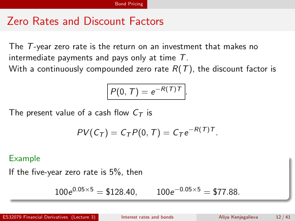

# lecture-3: physical PDF page 12

<a id="lecture-3-pdfPage-012"></a>

- Source ID: `lecture-3`
- Original: `context/lecture slides/Lecture 3 Interest rates and bonds.pdf`
- Original SHA-256: `df4aabe19a4bf757759406b1a8b4c95f4ab1656361d68456c6c2fdacf5ab047e`
- Locator: `pdfPage:12` (physical page; not printed slide numbering)
- Fidelity status: raw layout extraction; independent visual QA pending. Equations, glyphs and diagrams are not certified by extraction success.



## Uncorrected layout extraction

```text
                                             Bond Pricing


 Zero Rates and Discount Factors

  The T -year zero rate is the return on an investment that makes no
  intermediate payments and pays only at time T .
  With a continuously compounded zero rate R(T ), the discount factor is

                                            P(0, T ) = e −R(T )T .

  The present value of a cash flow CT is

                                PV (CT ) = CT P(0, T ) = CT e −R(T )T .

  Example
  If the five-year zero rate is 5%, then

                      100e 0.05×5 = $128.40,                   100e −0.05×5 = $77.88.

ES32079 Financial Derivatives (Lecture 3)      Interest rates and bonds        Aliya Kenjegalieva   12 / 41
```

> Math retrieval warning: the layout text flattens fractions, superscripts, subscripts and sums. Inspect the linked original page image before teaching or transcribing mathematics. Image preservation is not verified mathematical text.
