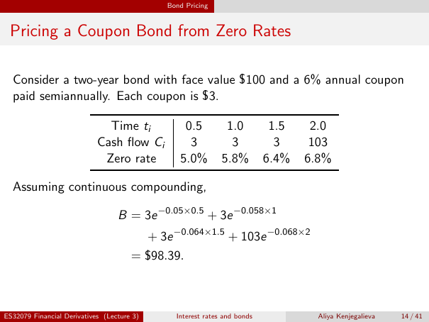

# lecture-3: physical PDF page 14

<a id="lecture-3-pdfPage-014"></a>

- Source ID: `lecture-3`
- Original: `context/lecture slides/Lecture 3 Interest rates and bonds.pdf`
- Original SHA-256: `df4aabe19a4bf757759406b1a8b4c95f4ab1656361d68456c6c2fdacf5ab047e`
- Locator: `pdfPage:14` (physical page; not printed slide numbering)
- Fidelity status: raw layout extraction; independent visual QA pending. Equations, glyphs and diagrams are not certified by extraction success.



## Uncorrected layout extraction

```text
                                               Bond Pricing


 Pricing a Coupon Bond from Zero Rates

  Consider a two-year bond with face value $100 and a 6% annual coupon
  paid semiannually. Each coupon is $3.

                              Time ti              0.5          1.0          1.5    2.0
                            Cash flow Ci            3            3            3     103
                             Zero rate            5.0%         5.8%         6.4%   6.8%

  Assuming continuous compounding,

                                  B = 3e −0.05×0.5 + 3e −0.058×1
                                            + 3e −0.064×1.5 + 103e −0.068×2
                                      = $98.39.


ES32079 Financial Derivatives (Lecture 3)        Interest rates and bonds            Aliya Kenjegalieva   14 / 41
```

> Math retrieval warning: the layout text flattens fractions, superscripts, subscripts and sums. Inspect the linked original page image before teaching or transcribing mathematics. Image preservation is not verified mathematical text.
