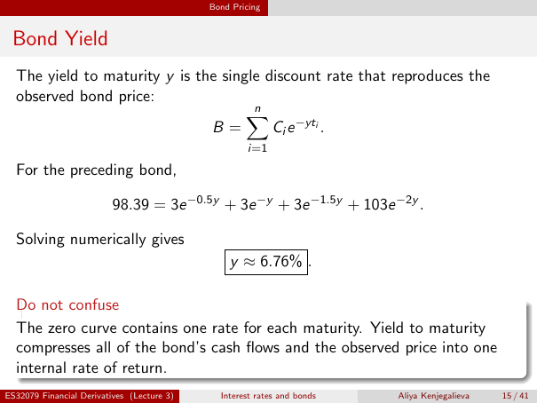

# lecture-3: physical PDF page 15

<a id="lecture-3-pdfPage-015"></a>

- Source ID: `lecture-3`
- Original: `context/lecture slides/Lecture 3 Interest rates and bonds.pdf`
- Original SHA-256: `df4aabe19a4bf757759406b1a8b4c95f4ab1656361d68456c6c2fdacf5ab047e`
- Locator: `pdfPage:15` (physical page; not printed slide numbering)
- Fidelity status: raw layout extraction; independent visual QA pending. Equations, glyphs and diagrams are not certified by extraction success.



## Uncorrected layout extraction

```text
                                            Bond Pricing


 Bond Yield
  The yield to maturity y is the single discount rate that reproduces the
  observed bond price:
                                     Xn
                               B=        Ci e −yti .
                                                    i=1
  For the preceding bond,

                          98.39 = 3e −0.5y + 3e −y + 3e −1.5y + 103e −2y .

  Solving numerically gives
                                                y ≈ 6.76% .

  Do not confuse
  The zero curve contains one rate for each maturity. Yield to maturity
  compresses all of the bond’s cash flows and the observed price into one
  internal rate of return.
ES32079 Financial Derivatives (Lecture 3)     Interest rates and bonds   Aliya Kenjegalieva   15 / 41
```

> Math retrieval warning: the layout text flattens fractions, superscripts, subscripts and sums. Inspect the linked original page image before teaching or transcribing mathematics. Image preservation is not verified mathematical text.
