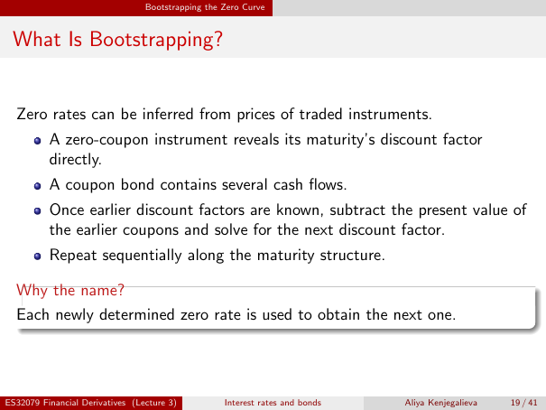

# lecture-3: physical PDF page 19

<a id="lecture-3-pdfPage-019"></a>

- Source ID: `lecture-3`
- Original: `context/lecture slides/Lecture 3 Interest rates and bonds.pdf`
- Original SHA-256: `df4aabe19a4bf757759406b1a8b4c95f4ab1656361d68456c6c2fdacf5ab047e`
- Locator: `pdfPage:19` (physical page; not printed slide numbering)
- Fidelity status: raw layout extraction; independent visual QA pending. Equations, glyphs and diagrams are not certified by extraction success.



## Uncorrected layout extraction

```text
                                 Bootstrapping the Zero Curve


 What Is Bootstrapping?


  Zero rates can be inferred from prices of traded instruments.
          A zero-coupon instrument reveals its maturity’s discount factor
          directly.
          A coupon bond contains several cash flows.
          Once earlier discount factors are known, subtract the present value of
          the earlier coupons and solve for the next discount factor.
          Repeat sequentially along the maturity structure.

  Why the name?
  Each newly determined zero rate is used to obtain the next one.


ES32079 Financial Derivatives (Lecture 3)          Interest rates and bonds   Aliya Kenjegalieva   19 / 41
```
