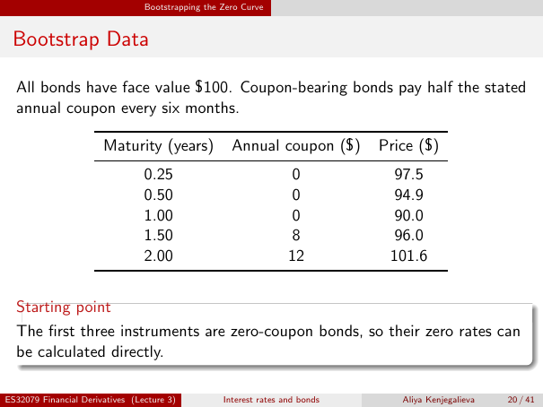

# lecture-3: physical PDF page 20

<a id="lecture-3-pdfPage-020"></a>

- Source ID: `lecture-3`
- Original: `context/lecture slides/Lecture 3 Interest rates and bonds.pdf`
- Original SHA-256: `df4aabe19a4bf757759406b1a8b4c95f4ab1656361d68456c6c2fdacf5ab047e`
- Locator: `pdfPage:20` (physical page; not printed slide numbering)
- Fidelity status: raw layout extraction; independent visual QA pending. Equations, glyphs and diagrams are not certified by extraction success.



## Uncorrected layout extraction

```text
                                 Bootstrapping the Zero Curve


 Bootstrap Data

  All bonds have face value $100. Coupon-bearing bonds pay half the stated
  annual coupon every six months.

                       Maturity (years)              Annual coupon ($)        Price ($)
                                 0.25                               0           97.5
                                 0.50                               0           94.9
                                 1.00                               0           90.0
                                 1.50                               8           96.0
                                 2.00                              12          101.6


  Starting point
  The first three instruments are zero-coupon bonds, so their zero rates can
  be calculated directly.

ES32079 Financial Derivatives (Lecture 3)          Interest rates and bonds      Aliya Kenjegalieva   20 / 41
```
