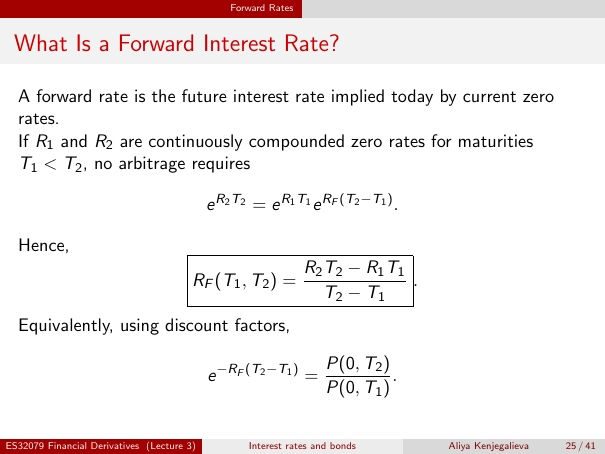

# lecture-3: physical PDF page 25

<a id="lecture-3-pdfPage-025"></a>

- Source ID: `lecture-3`
- Original: `context/lecture slides/Lecture 3 Interest rates and bonds.pdf`
- Original SHA-256: `df4aabe19a4bf757759406b1a8b4c95f4ab1656361d68456c6c2fdacf5ab047e`
- Locator: `pdfPage:25` (physical page; not printed slide numbering)
- Fidelity status: raw layout extraction; independent visual QA pending. Equations, glyphs and diagrams are not certified by extraction success.



## Uncorrected layout extraction

```text
                                                Forward Rates


 What Is a Forward Interest Rate?

  A forward rate is the future interest rate implied today by current zero
  rates.
  If R1 and R2 are continuously compounded zero rates for maturities
  T1 < T2 , no arbitrage requires

                                            e R2 T2 = e R1 T1 e RF (T2 −T1 ) .

  Hence,
                                                                R2 T2 − R1 T1
                                        RF (T1 , T2 ) =                       .
                                                                   T2 − T1
  Equivalently, using discount factors,

                                                                    P(0, T2 )
                                            e −RF (T2 −T1 ) =                 .
                                                                    P(0, T1 )


ES32079 Financial Derivatives (Lecture 3)          Interest rates and bonds       Aliya Kenjegalieva   25 / 41
```

> Math retrieval warning: the layout text flattens fractions, superscripts, subscripts and sums. Inspect the linked original page image before teaching or transcribing mathematics. Image preservation is not verified mathematical text.
