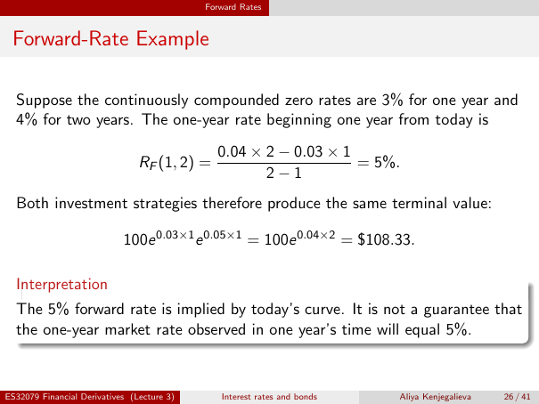

# lecture-3: physical PDF page 26

<a id="lecture-3-pdfPage-026"></a>

- Source ID: `lecture-3`
- Original: `context/lecture slides/Lecture 3 Interest rates and bonds.pdf`
- Original SHA-256: `df4aabe19a4bf757759406b1a8b4c95f4ab1656361d68456c6c2fdacf5ab047e`
- Locator: `pdfPage:26` (physical page; not printed slide numbering)
- Fidelity status: raw layout extraction; independent visual QA pending. Equations, glyphs and diagrams are not certified by extraction success.



## Uncorrected layout extraction

```text
                                            Forward Rates


 Forward-Rate Example

  Suppose the continuously compounded zero rates are 3% for one year and
  4% for two years. The one-year rate beginning one year from today is
                                              0.04 × 2 − 0.03 × 1
                                RF (1, 2) =                       = 5%.
                                                     2−1
  Both investment strategies therefore produce the same terminal value:

                            100e 0.03×1 e 0.05×1 = 100e 0.04×2 = $108.33.

  Interpretation
  The 5% forward rate is implied by today’s curve. It is not a guarantee that
  the one-year market rate observed in one year’s time will equal 5%.


ES32079 Financial Derivatives (Lecture 3)      Interest rates and bonds   Aliya Kenjegalieva   26 / 41
```

> Math retrieval warning: the layout text flattens fractions, superscripts, subscripts and sums. Inspect the linked original page image before teaching or transcribing mathematics. Image preservation is not verified mathematical text.
