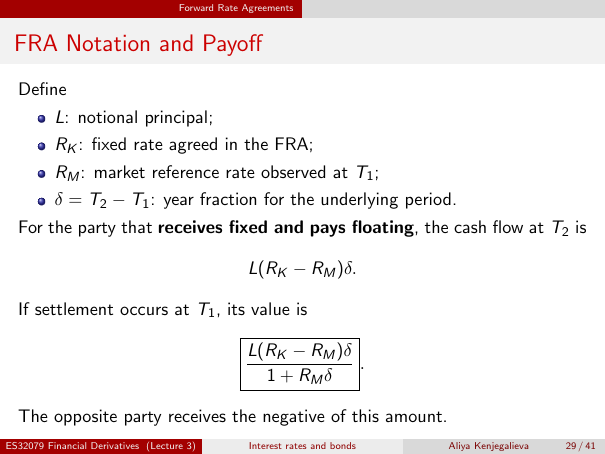

# lecture-3: physical PDF page 29

<a id="lecture-3-pdfPage-029"></a>

- Source ID: `lecture-3`
- Original: `context/lecture slides/Lecture 3 Interest rates and bonds.pdf`
- Original SHA-256: `df4aabe19a4bf757759406b1a8b4c95f4ab1656361d68456c6c2fdacf5ab047e`
- Locator: `pdfPage:29` (physical page; not printed slide numbering)
- Fidelity status: raw layout extraction; independent visual QA pending. Equations, glyphs and diagrams are not certified by extraction success.



## Uncorrected layout extraction

```text
                                     Forward Rate Agreements


 FRA Notation and Payoff
  Define
          L: notional principal;
          RK : fixed rate agreed in the FRA;
          RM : market reference rate observed at T1 ;
          δ = T2 − T1 : year fraction for the underlying period.
  For the party that receives fixed and pays floating, the cash flow at T2 is

                                                  L(RK − RM )δ.

  If settlement occurs at T1 , its value is

                                                  L(RK − RM )δ
                                                               .
                                                    1 + RM δ

  The opposite party receives the negative of this amount.
ES32079 Financial Derivatives (Lecture 3)          Interest rates and bonds   Aliya Kenjegalieva   29 / 41
```

> Math retrieval warning: the layout text flattens fractions, superscripts, subscripts and sums. Inspect the linked original page image before teaching or transcribing mathematics. Image preservation is not verified mathematical text.
