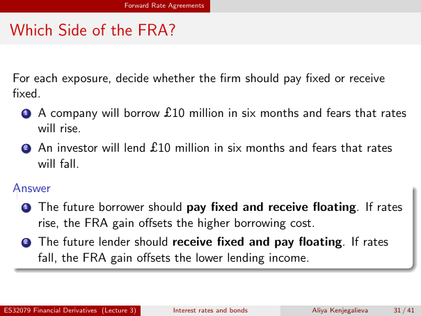

# lecture-3: physical PDF page 31

<a id="lecture-3-pdfPage-031"></a>

- Source ID: `lecture-3`
- Original: `context/lecture slides/Lecture 3 Interest rates and bonds.pdf`
- Original SHA-256: `df4aabe19a4bf757759406b1a8b4c95f4ab1656361d68456c6c2fdacf5ab047e`
- Locator: `pdfPage:31` (physical page; not printed slide numbering)
- Fidelity status: raw layout extraction; independent visual QA pending. Equations, glyphs and diagrams are not certified by extraction success.



## Uncorrected layout extraction

```text
                                     Forward Rate Agreements


 Which Side of the FRA?

  For each exposure, decide whether the firm should pay fixed or receive
  fixed.
      1   A company will borrow £10 million in six months and fears that rates
          will rise.
      2   An investor will lend £10 million in six months and fears that rates
          will fall.
  Answer
   1 The future borrower should pay fixed and receive floating. If rates

      rise, the FRA gain offsets the higher borrowing cost.
      2   The future lender should receive fixed and pay floating. If rates
          fall, the FRA gain offsets the lower lending income.


ES32079 Financial Derivatives (Lecture 3)          Interest rates and bonds   Aliya Kenjegalieva   31 / 41
```
