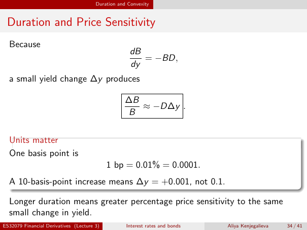

# lecture-3: physical PDF page 34

<a id="lecture-3-pdfPage-034"></a>

- Source ID: `lecture-3`
- Original: `context/lecture slides/Lecture 3 Interest rates and bonds.pdf`
- Original SHA-256: `df4aabe19a4bf757759406b1a8b4c95f4ab1656361d68456c6c2fdacf5ab047e`
- Locator: `pdfPage:34` (physical page; not printed slide numbering)
- Fidelity status: raw layout extraction; independent visual QA pending. Equations, glyphs and diagrams are not certified by extraction success.



## Uncorrected layout extraction

```text
                                       Duration and Convexity


 Duration and Price Sensitivity
  Because
                                                     dB
                                                        = −BD,
                                                     dy
  a small yield change ∆y produces

                                                   ∆B
                                                      ≈ −D∆y .
                                                   B


  Units matter
  One basis point is
                                            1 bp = 0.01% = 0.0001.
  A 10-basis-point increase means ∆y = +0.001, not 0.1.

  Longer duration means greater percentage price sensitivity to the same
  small change in yield.
ES32079 Financial Derivatives (Lecture 3)          Interest rates and bonds   Aliya Kenjegalieva   34 / 41
```

> Math retrieval warning: the layout text flattens fractions, superscripts, subscripts and sums. Inspect the linked original page image before teaching or transcribing mathematics. Image preservation is not verified mathematical text.
