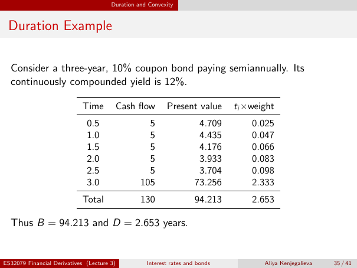

# lecture-3: physical PDF page 35

<a id="lecture-3-pdfPage-035"></a>

- Source ID: `lecture-3`
- Original: `context/lecture slides/Lecture 3 Interest rates and bonds.pdf`
- Original SHA-256: `df4aabe19a4bf757759406b1a8b4c95f4ab1656361d68456c6c2fdacf5ab047e`
- Locator: `pdfPage:35` (physical page; not printed slide numbering)
- Fidelity status: raw layout extraction; independent visual QA pending. Equations, glyphs and diagrams are not certified by extraction success.



## Uncorrected layout extraction

```text
                                       Duration and Convexity


 Duration Example

  Consider a three-year, 10% coupon bond paying semiannually. Its
  continuously compounded yield is 12%.

                            Time        Cash flow         Present value       ti ×weight
                              0.5                  5                  4.709       0.025
                              1.0                  5                  4.435       0.047
                              1.5                  5                  4.176       0.066
                              2.0                  5                  3.933       0.083
                              2.5                  5                  3.704       0.098
                              3.0                105                 73.256       2.333
                            Total                130                 94.213       2.653

  Thus B = 94.213 and D = 2.653 years.


ES32079 Financial Derivatives (Lecture 3)          Interest rates and bonds          Aliya Kenjegalieva   35 / 41
```

> Math retrieval warning: the layout text flattens fractions, superscripts, subscripts and sums. Inspect the linked original page image before teaching or transcribing mathematics. Image preservation is not verified mathematical text.
