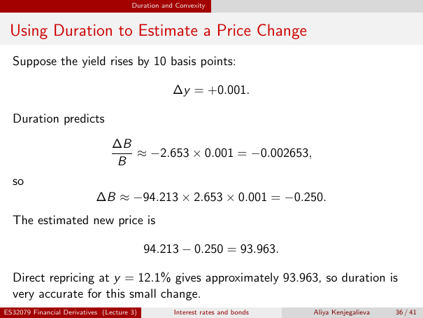

# lecture-3: physical PDF page 36

<a id="lecture-3-pdfPage-036"></a>

- Source ID: `lecture-3`
- Original: `context/lecture slides/Lecture 3 Interest rates and bonds.pdf`
- Original SHA-256: `df4aabe19a4bf757759406b1a8b4c95f4ab1656361d68456c6c2fdacf5ab047e`
- Locator: `pdfPage:36` (physical page; not printed slide numbering)
- Fidelity status: raw layout extraction; independent visual QA pending. Equations, glyphs and diagrams are not certified by extraction success.



## Uncorrected layout extraction

```text
                                       Duration and Convexity


 Using Duration to Estimate a Price Change
  Suppose the yield rises by 10 basis points:

                                                   ∆y = +0.001.

  Duration predicts
                                 ∆B
                                    ≈ −2.653 × 0.001 = −0.002653,
                                 B
  so
                            ∆B ≈ −94.213 × 2.653 × 0.001 = −0.250.
  The estimated new price is

                                            94.213 − 0.250 = 93.963.

  Direct repricing at y = 12.1% gives approximately 93.963, so duration is
  very accurate for this small change.
ES32079 Financial Derivatives (Lecture 3)          Interest rates and bonds   Aliya Kenjegalieva   36 / 41
```

> Math retrieval warning: the layout text flattens fractions, superscripts, subscripts and sums. Inspect the linked original page image before teaching or transcribing mathematics. Image preservation is not verified mathematical text.
