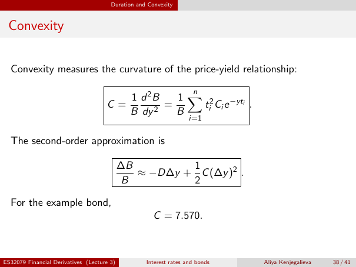

# lecture-3: physical PDF page 38

<a id="lecture-3-pdfPage-038"></a>

- Source ID: `lecture-3`
- Original: `context/lecture slides/Lecture 3 Interest rates and bonds.pdf`
- Original SHA-256: `df4aabe19a4bf757759406b1a8b4c95f4ab1656361d68456c6c2fdacf5ab047e`
- Locator: `pdfPage:38` (physical page; not printed slide numbering)
- Fidelity status: raw layout extraction; independent visual QA pending. Equations, glyphs and diagrams are not certified by extraction success.



## Uncorrected layout extraction

```text
                                       Duration and Convexity


 Convexity


  Convexity measures the curvature of the price-yield relationship:

                                                                    n
                                              1 d 2B   1 X 2 −yti
                                     C=              =    t i Ci e .
                                              B dy 2   B
                                                                   i=1


  The second-order approximation is

                                            ∆B         1
                                               ≈ −D∆y + C (∆y )2 .
                                            B          2

  For the example bond,
                                                     C = 7.570.


ES32079 Financial Derivatives (Lecture 3)          Interest rates and bonds   Aliya Kenjegalieva   38 / 41
```

> Math retrieval warning: the layout text flattens fractions, superscripts, subscripts and sums. Inspect the linked original page image before teaching or transcribing mathematics. Image preservation is not verified mathematical text.
