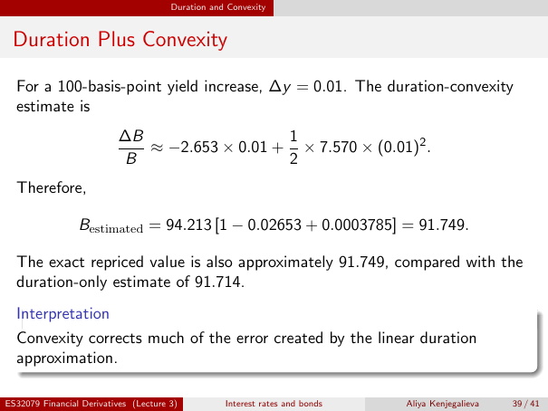

# lecture-3: physical PDF page 39

<a id="lecture-3-pdfPage-039"></a>

- Source ID: `lecture-3`
- Original: `context/lecture slides/Lecture 3 Interest rates and bonds.pdf`
- Original SHA-256: `df4aabe19a4bf757759406b1a8b4c95f4ab1656361d68456c6c2fdacf5ab047e`
- Locator: `pdfPage:39` (physical page; not printed slide numbering)
- Fidelity status: raw layout extraction; independent visual QA pending. Equations, glyphs and diagrams are not certified by extraction success.



## Uncorrected layout extraction

```text
                                       Duration and Convexity


 Duration Plus Convexity

  For a 100-basis-point yield increase, ∆y = 0.01. The duration-convexity
  estimate is
                          ∆B                  1
                             ≈ −2.653 × 0.01 + × 7.570 × (0.01)2 .
                          B                   2
  Therefore,

                 Bestimated = 94.213 [1 − 0.02653 + 0.0003785] = 91.749.

  The exact repriced value is also approximately 91.749, compared with the
  duration-only estimate of 91.714.
  Interpretation
  Convexity corrects much of the error created by the linear duration
  approximation.

ES32079 Financial Derivatives (Lecture 3)          Interest rates and bonds   Aliya Kenjegalieva   39 / 41
```

> Math retrieval warning: the layout text flattens fractions, superscripts, subscripts and sums. Inspect the linked original page image before teaching or transcribing mathematics. Image preservation is not verified mathematical text.
