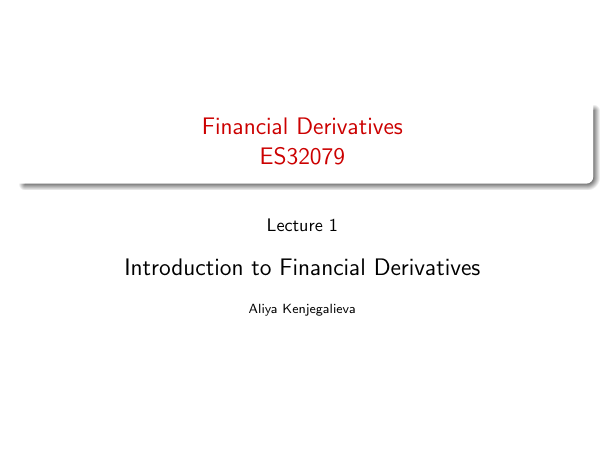

# Lecture 1 — physical page 1: Introduction to Financial Derivatives

**Authored normalized source transcription — needs independent review.** Typography, line breaks, table structure and mathematical notation are normalized; this is not a word-for-word facsimile or a tutorial lesson. Source-label caveats and notation/assumption clarifications are explicitly labelled. The linked original image and unchanged raw extraction remain the evidence.

[Raw page extraction](../../extracted/lecture-1/page-001.md) · [Original full-page image](../../assets/lecture-1/page-001.png)

## Title

**Source region:** full-page title block. **Classification:** administrative.

Financial Derivatives; ES32079; Lecture 1; Introduction to Financial Derivatives; Aliya Kenjegalieva. No printed page counter on this title page.

