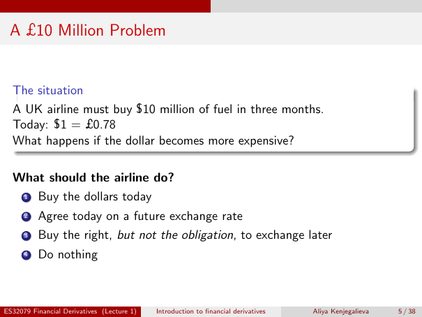

# Lecture 1 — physical page 5: A £10 Million Problem

**Authored normalized source transcription — needs independent review.** Typography, line breaks, table structure and mathematical notation are normalized; this is not a word-for-word facsimile or a tutorial lesson. Source-label caveats and notation/assumption clarifications are explicitly labelled. The linked original image and unchanged raw extraction remain the evidence.

[Raw page extraction](../../extracted/lecture-1/page-005.md) · [Original full-page image](../../assets/lecture-1/page-005.png)

## Airline exposure

**Source region:** upper situation box. **Classification:** substantive.

A UK airline must buy **$10 million** of fuel in three months. Today: $1 = £0.78. What happens if the dollar becomes more expensive?

**Source-label caveat (author annotation):** the title says “A £10 Million Problem”, while the scenario explicitly says **$10 million**. Both original currencies are preserved; the title is not used to change the stated exposure.

## Airline choices

**Source region:** lower numbered alternatives. **Classification:** substantive.

What should the airline do?
1. Buy the dollars today.
2. Agree today on a future exchange rate.
3. Buy the right, but not the obligation, to exchange later.
4. Do nothing.

The slide supplies these alternatives, not a selected answer.

**Authored source caution — not original slide content:** The slide title says £10 million but the scenario explicitly specifies $10 million; preserve that distinction rather than changing the exposure.

## Page frame

**Source region:** title/header/footer frame. **Classification:** administrative.

Page title: “A £10 Million Problem”. Printed footer: ES32079 Financial Derivatives (Lecture 1); Introduction to financial derivatives; Aliya Kenjegalieva; **5 / 38**. Physical PDF page 5 and printed counter agree. The footer is administrative source metadata, not a separate technical claim.

