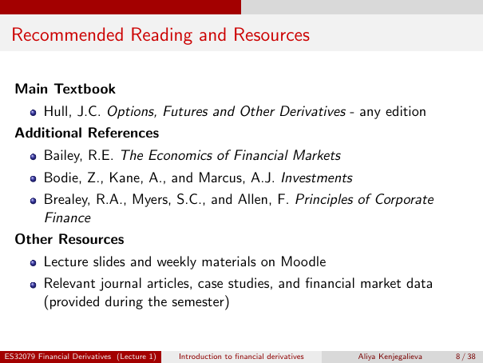

# Lecture 1 — physical page 8: Recommended Reading and Resources

**Authored normalized source transcription — needs independent review.** Typography, line breaks, table structure and mathematical notation are normalized; this is not a word-for-word facsimile or a tutorial lesson. Source-label caveats and notation/assumption clarifications are explicitly labelled. The linked original image and unchanged raw extraction remain the evidence.

[Raw page extraction](../../extracted/lecture-1/page-008.md) · [Original full-page image](../../assets/lecture-1/page-008.png)

## Reading list

**Source region:** main textbook and additional references. **Classification:** administrative.

Main textbook: Hull, J. C., *Options, Futures and Other Derivatives* — any edition.

Additional references:
- Bailey, R. E., *The Economics of Financial Markets*.
- Bodie, Z., Kane, A., and Marcus, A. J., *Investments*.
- Brealey, R. A., Myers, S. C., and Allen, F., *Principles of Corporate Finance*.

## Other resources

**Source region:** lower other-resources list. **Classification:** administrative.

- Lecture slides and weekly materials on Moodle.
- Relevant journal articles, case studies, and financial market data (provided during the semester).

A reading-list mention grants no exposure permission to the referenced material.

## Page frame

**Source region:** title/header/footer frame. **Classification:** administrative.

Page title: “Recommended Reading and Resources”. Printed footer: ES32079 Financial Derivatives (Lecture 1); Introduction to financial derivatives; Aliya Kenjegalieva; **8 / 38**. Physical PDF page 8 and printed counter agree. The footer is administrative source metadata, not a separate technical claim.

