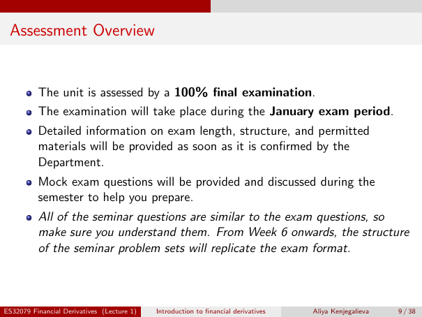

# Lecture 1 — physical page 9: Assessment Overview

**Authored normalized source transcription — needs independent review.** Typography, line breaks, table structure and mathematical notation are normalized; this is not a word-for-word facsimile or a tutorial lesson. Source-label caveats and notation/assumption clarifications are explicitly labelled. The linked original image and unchanged raw extraction remain the evidence.

[Raw page extraction](../../extracted/lecture-1/page-009.md) · [Original full-page image](../../assets/lecture-1/page-009.png)

## Assessment

**Source region:** whole assessment bullet list. **Classification:** administrative.

- The unit is assessed by a **100% final examination**.
- The examination will take place during the **January exam period**.
- Detailed information on exam length, structure, and permitted materials will be provided as soon as confirmed by the Department.
- Mock exam questions will be provided and discussed during the semester to help preparation.
- All seminar questions are similar to exam questions, so students should understand them. From Week 6 onwards, the seminar problem-set structure will replicate the exam format.

These are the source's announcements, not current verified exam regulations; no missing exam specification is invented.

## Page frame

**Source region:** title/header/footer frame. **Classification:** administrative.

Page title: “Assessment Overview”. Printed footer: ES32079 Financial Derivatives (Lecture 1); Introduction to financial derivatives; Aliya Kenjegalieva; **9 / 38**. Physical PDF page 9 and printed counter agree. The footer is administrative source metadata, not a separate technical claim.

