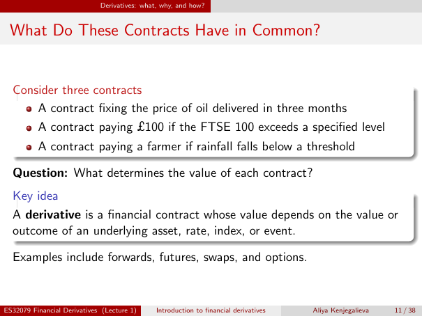

# Lecture 1 — physical page 11: What Do These Contracts Have in Common?

**Authored normalized source transcription — needs independent review.** Typography, line breaks, table structure and mathematical notation are normalized; this is not a word-for-word facsimile or a tutorial lesson. Source-label caveats and notation/assumption clarifications are explicitly labelled. The linked original image and unchanged raw extraction remain the evidence.

[Raw page extraction](../../extracted/lecture-1/page-011.md) · [Original full-page image](../../assets/lecture-1/page-011.png)

## Contract examples

**Source region:** upper three-contract box and question. **Classification:** substantive.

Consider three contracts:
- Fixing the price of oil delivered in three months.
- Paying £100 if the FTSE 100 exceeds a specified level.
- Paying a farmer if rainfall falls below a threshold.

Question: what determines the value of each contract?

## Derivative definition

**Source region:** lower key idea box. **Classification:** substantive.

A **derivative** is a financial contract whose value depends on the value or outcome of an underlying asset, rate, index, or event.

## Derivative types

**Source region:** bottom examples line. **Classification:** substantive.

Examples include forwards, futures, swaps, and options.

## Page frame

**Source region:** title/header/footer frame. **Classification:** administrative.

Page title: “What Do These Contracts Have in Common?”. Printed footer: ES32079 Financial Derivatives (Lecture 1); Introduction to financial derivatives; Aliya Kenjegalieva; **11 / 38**. Physical PDF page 11 and printed counter agree. The footer is administrative source metadata, not a separate technical claim.

