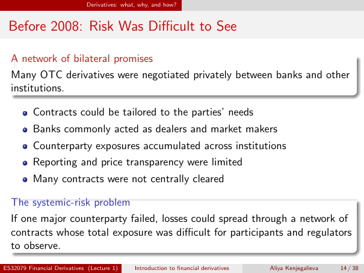

# Lecture 1 — physical page 14: Before 2008: Risk Was Difficult to See

**Authored normalized source transcription — needs independent review.** Typography, line breaks, table structure and mathematical notation are normalized; this is not a word-for-word facsimile or a tutorial lesson. Source-label caveats and notation/assumption clarifications are explicitly labelled. The linked original image and unchanged raw extraction remain the evidence.

[Raw page extraction](../../extracted/lecture-1/page-014.md) · [Original full-page image](../../assets/lecture-1/page-014.png)

## Bilateral market structure

**Source region:** upper bilateral promises box and central bullets. **Classification:** substantive.

Many OTC derivatives were negotiated privately between banks and other institutions.
- Contracts could be tailored to the parties' needs.
- Banks commonly acted as dealers and market makers.
- Counterparty exposures accumulated across institutions.
- Reporting and price transparency were limited.
- Many contracts were not centrally cleared.

## Systemic risk

**Source region:** lower systemic-risk box. **Classification:** substantive.

If one major counterparty failed, losses could spread through a network of contracts whose total exposure was difficult for participants and regulators to observe.

## Page frame

**Source region:** title/header/footer frame. **Classification:** administrative.

Page title: “Before 2008: Risk Was Difficult to See”. Printed footer: ES32079 Financial Derivatives (Lecture 1); Introduction to financial derivatives; Aliya Kenjegalieva; **14 / 38**. Physical PDF page 14 and printed counter agree. The footer is administrative source metadata, not a separate technical claim.

