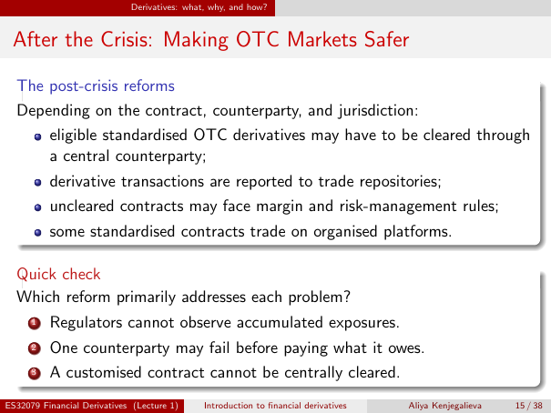

# Lecture 1 — physical page 15: After the Crisis: Making OTC Markets Safer

**Authored normalized source transcription — needs independent review.** Typography, line breaks, table structure and mathematical notation are normalized; this is not a word-for-word facsimile or a tutorial lesson. Source-label caveats and notation/assumption clarifications are explicitly labelled. The linked original image and unchanged raw extraction remain the evidence.

[Raw page extraction](../../extracted/lecture-1/page-015.md) · [Original full-page image](../../assets/lecture-1/page-015.png)

## Clearing reform

**Source region:** upper reform box, conditional lead-in and clearing bullet. **Classification:** substantive.

**Depending on the contract, counterparty, and jurisdiction**, eligible standardised OTC derivatives may have to be cleared through a central counterparty.

## Reporting reform

**Source region:** upper reform box, reporting bullet. **Classification:** substantive.

Derivative transactions are reported to trade repositories. The box's contract/counterparty/jurisdiction qualifier applies.

## Uncleared margin reform

**Source region:** upper reform box, uncleared-contract bullet. **Classification:** substantive.

Uncleared contracts may face margin and risk-management rules. The box's contract/counterparty/jurisdiction qualifier applies.

## Platform reform

**Source region:** upper reform box, trading-platform bullet. **Classification:** substantive.

Some standardised contracts trade on organised platforms. The box's contract/counterparty/jurisdiction qualifier applies.

## Reform matching

**Source region:** lower quick-check box. **Classification:** substantive.

Which reform primarily addresses each problem?
1. Regulators cannot observe accumulated exposures.
2. One counterparty may fail before paying what it owes.
3. A customised contract cannot be centrally cleared.

This is a source exercise; no extra official answer is supplied here.

## Page frame

**Source region:** title/header/footer frame. **Classification:** administrative.

Page title: “After the Crisis: Making OTC Markets Safer”. Printed footer: ES32079 Financial Derivatives (Lecture 1); Introduction to financial derivatives; Aliya Kenjegalieva; **15 / 38**. Physical PDF page 15 and printed counter agree. The footer is administrative source metadata, not a separate technical claim.

