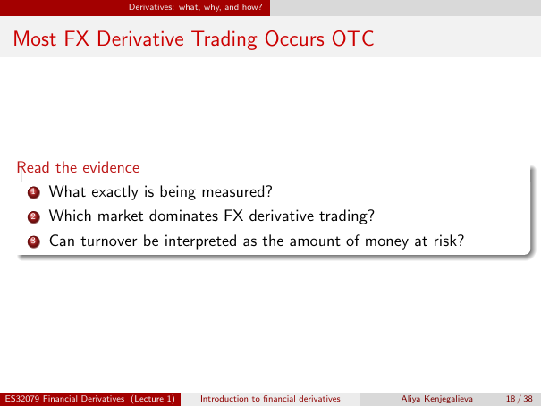

# Lecture 1 — physical page 18: Most FX Derivative Trading Occurs OTC

**Authored normalized source transcription — needs independent review.** Typography, line breaks, table structure and mathematical notation are normalized; this is not a word-for-word facsimile or a tutorial lesson. Source-label caveats and notation/assumption clarifications are explicitly labelled. The linked original image and unchanged raw extraction remain the evidence.

[Raw page extraction](../../extracted/lecture-1/page-018.md) · [Original full-page image](../../assets/lecture-1/page-018.png)

## Chart reading questions

**Source region:** central read-the-evidence box. **Classification:** substantive.

1. What exactly is being measured?
2. Which market dominates FX derivative trading?
3. Can turnover be interpreted as the amount of money at risk?

The chart is on physical page 17; physical page 18 contains these questions, not another chart.

## Page frame

**Source region:** title/header/footer frame. **Classification:** administrative.

Page title: “Most FX Derivative Trading Occurs OTC”. Printed footer: ES32079 Financial Derivatives (Lecture 1); Introduction to financial derivatives; Aliya Kenjegalieva; **18 / 38**. Physical PDF page 18 and printed counter agree. The footer is administrative source metadata, not a separate technical claim.

