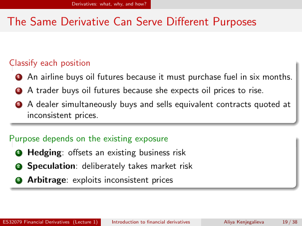

# Lecture 1 — physical page 19: The Same Derivative Can Serve Different Purposes

**Authored normalized source transcription — needs independent review.** Typography, line breaks, table structure and mathematical notation are normalized; this is not a word-for-word facsimile or a tutorial lesson. Source-label caveats and notation/assumption clarifications are explicitly labelled. The linked original image and unchanged raw extraction remain the evidence.

[Raw page extraction](../../extracted/lecture-1/page-019.md) · [Original full-page image](../../assets/lecture-1/page-019.png)

## Position classification

**Source region:** upper three-position box. **Classification:** substantive.

Classify each position:
1. An airline buys oil futures because it must purchase fuel in six months.
2. A trader buys oil futures because she expects oil prices to rise.
3. A dealer simultaneously buys and sells equivalent contracts quoted at inconsistent prices.

## Source classification answers

**Source region:** lower purpose box, three corresponding classifications. **Classification:** substantive.

Purpose depends on the existing exposure:
1. **Hedging:** offsets an existing business risk.
2. **Speculation:** deliberately takes market risk.
3. **Arbitrage:** exploits inconsistent prices.

## Page frame

**Source region:** title/header/footer frame. **Classification:** administrative.

Page title: “The Same Derivative Can Serve Different Purposes”. Printed footer: ES32079 Financial Derivatives (Lecture 1); Introduction to financial derivatives; Aliya Kenjegalieva; **19 / 38**. Physical PDF page 19 and printed counter agree. The footer is administrative source metadata, not a separate technical claim.

