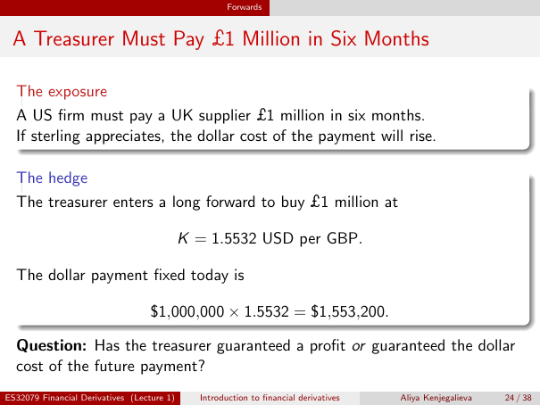

# Lecture 1 — physical page 24: A Treasurer Must Pay £1 Million in Six Months

**Authored normalized source transcription — needs independent review.** Typography, line breaks, table structure and mathematical notation are normalized; this is not a word-for-word facsimile or a tutorial lesson. Source-label caveats and notation/assumption clarifications are explicitly labelled. The linked original image and unchanged raw extraction remain the evidence.

[Raw page extraction](../../extracted/lecture-1/page-024.md) · [Original full-page image](../../assets/lecture-1/page-024.png)

## Sterling exposure

**Source region:** upper exposure box. **Classification:** substantive.

A US firm must pay a UK supplier £1 million in six months. If sterling appreciates, the dollar cost of the payment will rise.

**Authored source caution — not original slide content:** The source prints $1,000,000 in the multiplication although the exposure is £1 million. The dimensionally consistent interpretation is £1,000,000 × 1.5532 USD/GBP = $1,553,200; this is a labelled interpretation, not the literal printed currency prefix.

## Sterling forward hedge

**Source region:** middle hedge box, contract and calculation. **Classification:** substantive.

The treasurer enters a **long forward** to buy £1 million at

$$K=1.5532\ \text{USD per GBP}.$$

The source labels the dollar payment fixed today as

$$\$1{,}000{,}000\times1.5532=\$1{,}553{,}200.$$

**Source currency-label caveat (author annotation):** the printed multiplier is **$1,000,000**, although the preceding exposure and contract specify **£1,000,000**. The dimensionally consistent interpretation is £1,000,000 × 1.5532 USD/GBP = $1,553,200. This clarification does not change the printed PDF. “Fixed today” means the future payment amount is agreed today, not paid today.

## Hedge objective question

**Source region:** bottom question. **Classification:** substantive.

Has the treasurer guaranteed a profit or guaranteed the dollar cost of the future payment?

**Authored source caution — not original slide content:** The source prints $1,000,000 in the multiplication although the exposure is £1 million. The dimensionally consistent interpretation is £1,000,000 × 1.5532 USD/GBP = $1,553,200; this is a labelled interpretation, not the literal printed currency prefix.

## Page frame

**Source region:** title/header/footer frame. **Classification:** administrative.

Page title: “A Treasurer Must Pay £1 Million in Six Months”. Printed footer: ES32079 Financial Derivatives (Lecture 1); Introduction to financial derivatives; Aliya Kenjegalieva; **24 / 38**. Physical PDF page 24 and printed counter agree. The footer is administrative source metadata, not a separate technical claim.

