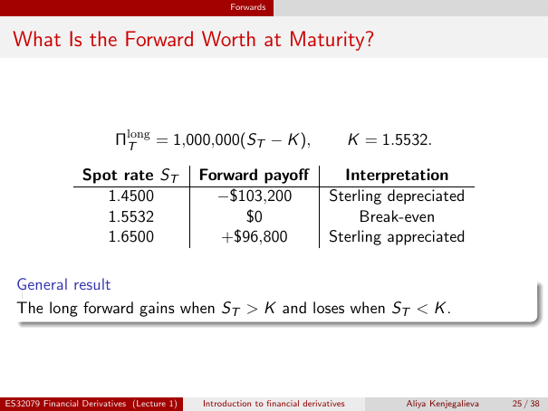

# Lecture 1 — physical page 25: What Is the Forward Worth at Maturity?

**Authored normalized source transcription — needs independent review.** Typography, line breaks, table structure and mathematical notation are normalized; this is not a word-for-word facsimile or a tutorial lesson. Source-label caveats and notation/assumption clarifications are explicitly labelled. The linked original image and unchanged raw extraction remain the evidence.

[Raw page extraction](../../extracted/lecture-1/page-025.md) · [Original full-page image](../../assets/lecture-1/page-025.png)

## Currency payoff formula

**Source region:** upper payoff equation. **Classification:** substantive.

$$\Pi_T^{\mathrm{long}}=1{,}000{,}000(S_T-K),\qquad K=1.5532.$$

Here the contract is for £1,000,000; $S_T$ and $K$ are USD per GBP, so the payoff is USD.

## Currency payoff table

**Source region:** central three-row payoff table. **Classification:** substantive.

| Spot rate $S_T$ | Forward payoff | Interpretation |
|---|---|---|
| 1.4500 | −$103,200 | Sterling depreciated |
| 1.5532 | $0 | Break-even |
| 1.6500 | +$96,800 | Sterling appreciated |

Exchange rates are USD per GBP; the payoff is for the £1 million long forward, not the total commercial exposure.

## Currency payoff direction

**Source region:** lower general-result box. **Classification:** substantive.

The long forward gains when $S_T>K$ and loses when $S_T<K$.

## Page frame

**Source region:** title/header/footer frame. **Classification:** administrative.

Page title: “What Is the Forward Worth at Maturity?”. Printed footer: ES32079 Financial Derivatives (Lecture 1); Introduction to financial derivatives; Aliya Kenjegalieva; **25 / 38**. Physical PDF page 25 and printed counter agree. The footer is administrative source metadata, not a separate technical claim.

