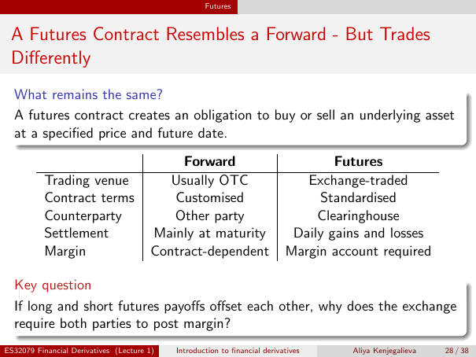

# Lecture 1 — physical page 28: A Futures Contract Resembles a Forward — But Trades Differently

**Authored normalized source transcription — needs independent review.** Typography, line breaks, table structure and mathematical notation are normalized; this is not a word-for-word facsimile or a tutorial lesson. Source-label caveats and notation/assumption clarifications are explicitly labelled. The linked original image and unchanged raw extraction remain the evidence.

[Raw page extraction](../../extracted/lecture-1/page-028.md) · [Original full-page image](../../assets/lecture-1/page-028.png)

## Futures obligation

**Source region:** upper what-remains-the-same box. **Classification:** substantive.

A futures contract creates an obligation to buy or sell an underlying asset at a specified price and future date.

## Forward futures comparison

**Source region:** central forward-versus-futures table. **Classification:** substantive.

| Feature | Forward | Futures |
|---|---|---|
| Trading venue | Usually OTC | Exchange-traded |
| Contract terms | Customised | Standardised |
| Counterparty | Other party | Clearinghouse |
| Settlement | Mainly at maturity | Daily gains and losses |
| Margin | Contract-dependent | Margin account required |

## Both sides margin question

**Source region:** lower key-question box. **Classification:** substantive.

If long and short futures payoffs offset each other, why does the exchange require both parties to post margin?

## Page frame

**Source region:** title/header/footer frame. **Classification:** administrative.

Page title: “A Futures Contract Resembles a Forward — But Trades Differently”. Printed footer: ES32079 Financial Derivatives (Lecture 1); Introduction to financial derivatives; Aliya Kenjegalieva; **28 / 38**. Physical PDF page 28 and printed counter agree. The footer is administrative source metadata, not a separate technical claim.

