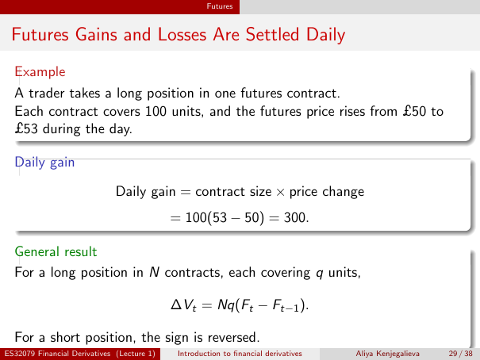

# Lecture 1 — physical page 29: Futures Gains and Losses Are Settled Daily

**Authored normalized source transcription — needs independent review.** Typography, line breaks, table structure and mathematical notation are normalized; this is not a word-for-word facsimile or a tutorial lesson. Source-label caveats and notation/assumption clarifications are explicitly labelled. The linked original image and unchanged raw extraction remain the evidence.

[Raw page extraction](../../extracted/lecture-1/page-029.md) · [Original full-page image](../../assets/lecture-1/page-029.png)

## Daily futures example

**Source region:** upper example box. **Classification:** substantive.

A trader takes a long position in one futures contract. Each contract covers 100 units; the futures price rises from £50 to £53 during the day.

## Daily gain calculation

**Source region:** middle daily-gain box. **Classification:** substantive.

Daily gain = contract size × price change:

$$100(53-50)=300.$$

The numbers are 100 units and pounds per unit, so the long position gains £300.

## Daily gain formula

**Source region:** lower general-result box. **Classification:** substantive.

For a long position in $N$ contracts, each covering $q$ units,

$$\Delta V_t=Nq(F_t-F_{t-1}).$$

For a short position the sign is reversed. In this notation $F_t$ and $F_{t-1}$ are the current and preceding day's futures prices per unit; $\Delta V_t$ is the day's value change. The time difference is **inside** the parentheses and multiplied by the entire $Nq$ position.

## Page frame

**Source region:** title/header/footer frame. **Classification:** administrative.

Page title: “Futures Gains and Losses Are Settled Daily”. Printed footer: ES32079 Financial Derivatives (Lecture 1); Introduction to financial derivatives; Aliya Kenjegalieva; **29 / 38**. Physical PDF page 29 and printed counter agree. The footer is administrative source metadata, not a separate technical claim.

