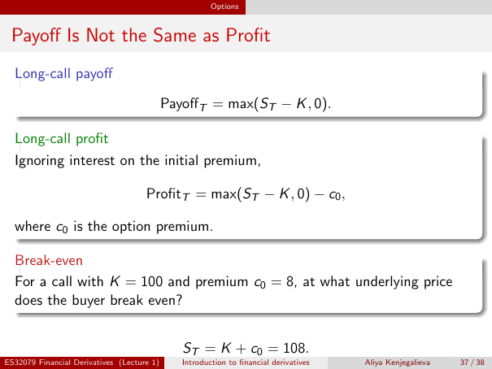

# Lecture 1 — physical page 37: Payoff Is Not the Same as Profit

**Authored normalized source transcription — needs independent review.** Typography, line breaks, table structure and mathematical notation are normalized; this is not a word-for-word facsimile or a tutorial lesson. Source-label caveats and notation/assumption clarifications are explicitly labelled. The linked original image and unchanged raw extraction remain the evidence.

[Raw page extraction](../../extracted/lecture-1/page-037.md) · [Original full-page image](../../assets/lecture-1/page-037.png)

## Call payoff

**Source region:** upper long-call payoff box. **Classification:** substantive.

$$\mathrm{Payoff}_T=\max(S_T-K,0).$$

$S_T$ denotes the maturity underlying price and $K$ the strike price.

## Call profit

**Source region:** middle long-call profit box. **Classification:** substantive.

Ignoring interest on the initial premium,

$$\mathrm{Profit}_T=\max(S_T-K,0)-c_0,$$

where $c_0$ is the option premium. The premium is subtracted **outside** the maximum.

## Call break even question

**Source region:** lower break-even question box. **Classification:** substantive.

For a call with $K=100$ and premium $c_0=8$, at what underlying price does the buyer break even?

**Authored convention reminder:** apply the source's stated convention of ignoring interest on the initial premium to this question.

## Call break even answer

**Source region:** bottom break-even equation. **Classification:** substantive.

$$S_T=K+c_0=108.$$

This is the source's break-even answer under its stated convention of ignoring premium interest.

## Page frame

**Source region:** title/header/footer frame. **Classification:** administrative.

Page title: “Payoff Is Not the Same as Profit”. Printed footer: ES32079 Financial Derivatives (Lecture 1); Introduction to financial derivatives; Aliya Kenjegalieva; **37 / 38**. Physical PDF page 37 and printed counter agree. The footer is administrative source metadata, not a separate technical claim.

