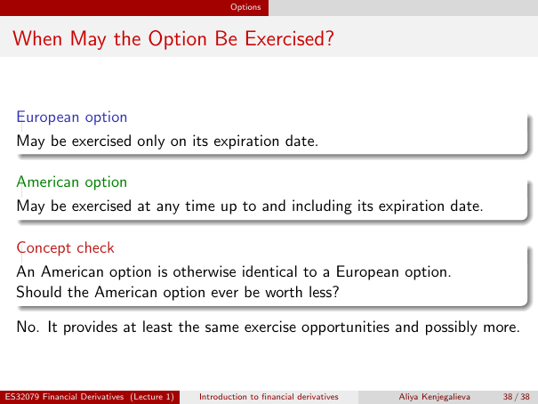

# Lecture 1 — physical page 38: When May the Option Be Exercised?

**Authored normalized source transcription — needs independent review.** Typography, line breaks, table structure and mathematical notation are normalized; this is not a word-for-word facsimile or a tutorial lesson. Source-label caveats and notation/assumption clarifications are explicitly labelled. The linked original image and unchanged raw extraction remain the evidence.

[Raw page extraction](../../extracted/lecture-1/page-038.md) · [Original full-page image](../../assets/lecture-1/page-038.png)

## European exercise

**Source region:** upper European-option box. **Classification:** substantive.

A **European option** may be exercised only on its expiration date.

## American exercise

**Source region:** middle American-option box. **Classification:** substantive.

An **American option** may be exercised at any time up to and including its expiration date.

## Exercise opportunity question

**Source region:** lower concept-check box. **Classification:** substantive.

An American option is otherwise identical to a European option. Should the American option ever be worth less?

## Exercise opportunity answer

**Source region:** bottom source answer. **Classification:** substantive.

No. It provides at least the same exercise opportunities and possibly more.

## Page frame

**Source region:** title/header/footer frame. **Classification:** administrative.

Page title: “When May the Option Be Exercised?”. Printed footer: ES32079 Financial Derivatives (Lecture 1); Introduction to financial derivatives; Aliya Kenjegalieva; **38 / 38**. Physical PDF page 38 and printed counter agree. The footer is administrative source metadata, not a separate technical claim.

