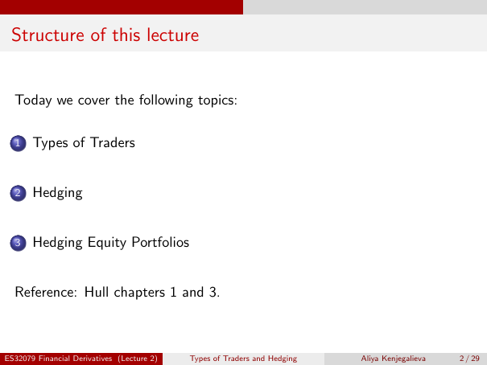

# Lecture 2 — physical page 2: Structure of this lecture

**Authored normalized source transcription — needs independent review.** Typography, line breaks, table structure and mathematical notation are normalized; this is not a word-for-word facsimile or a tutorial lesson. Source-label caveats and notation/assumption clarifications are explicitly labelled. The linked original image and unchanged raw extraction remain the evidence.

[Raw page extraction](../../extracted/lecture-2/page-002.md) · [Original full-page image](../../assets/lecture-2/page-002.png)

## Outline

**Source region:** whole lecture-outline list and reference. **Classification:** administrative.

Today:
1. Types of Traders.
2. Hedging.
3. Hedging Equity Portfolios.

Reference: Hull chapters 1 and 3.

## Page frame

**Source region:** title/header/footer frame. **Classification:** administrative.

Page title: “Structure of this lecture”. Printed footer: ES32079 Financial Derivatives (Lecture 2); Types of Traders and Hedging; Aliya Kenjegalieva; **2 / 29**. Physical PDF page 2 and printed counter agree. The footer is administrative source metadata, not a separate technical claim.

