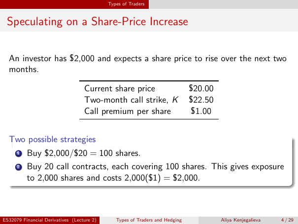

# Lecture 2 — physical page 4: Speculating on a Share-Price Increase

**Authored normalized source transcription — needs independent review.** Typography, line breaks, table structure and mathematical notation are normalized; this is not a word-for-word facsimile or a tutorial lesson. Source-label caveats and notation/assumption clarifications are explicitly labelled. The linked original image and unchanged raw extraction remain the evidence.

[Raw page extraction](../../extracted/lecture-2/page-004.md) · [Original full-page image](../../assets/lecture-2/page-004.png)

## Speculation inputs

**Source region:** upper scenario and input table. **Classification:** substantive.

An investor has $2,000 and expects a share price to rise over the next two months.

| Input | Amount |
|---|---|
| Current share price | $20.00 |
| Two-month call strike, $K$ | $22.50 |
| Call premium per share | $1.00 |

## Share strategy

**Source region:** lower strategies box, item 1. **Classification:** substantive.

Buy $2,000 / $20 = **100 shares**.

## Call strategy

**Source region:** lower strategies box, item 2. **Classification:** substantive.

Buy **20 call contracts**, each covering **100 shares**. This gives exposure to **2,000 shares** and costs 2,000($1) = **$2,000**.

## Page frame

**Source region:** title/header/footer frame. **Classification:** administrative.

Page title: “Speculating on a Share-Price Increase”. Printed footer: ES32079 Financial Derivatives (Lecture 2); Types of Traders and Hedging; Aliya Kenjegalieva; **4 / 29**. Physical PDF page 4 and printed counter agree. The footer is administrative source metadata, not a separate technical claim.

