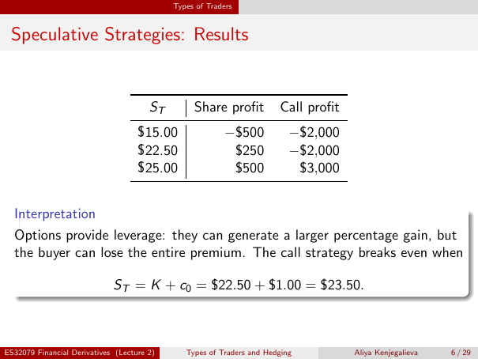

# Lecture 2 — physical page 6: Speculative Strategies: Results

**Authored normalized source transcription — needs independent review.** Typography, line breaks, table structure and mathematical notation are normalized; this is not a word-for-word facsimile or a tutorial lesson. Source-label caveats and notation/assumption clarifications are explicitly labelled. The linked original image and unchanged raw extraction remain the evidence.

[Raw page extraction](../../extracted/lecture-2/page-006.md) · [Original full-page image](../../assets/lecture-2/page-006.png)

## Strategy results table

**Source region:** upper share-versus-call profit table. **Classification:** substantive.

| $S_T$ | Share profit | Call profit |
|---|---|---|
| $15.00 | −$500 | −$2,000 |
| $22.50 | $250 | −$2,000 |
| $25.00 | $500 | $3,000 |

## Option leverage

**Source region:** lower interpretation text. **Classification:** substantive.

Options provide leverage: they can generate a larger percentage gain, but the buyer can lose the entire premium.

## Call break even

**Source region:** lower break-even equation. **Classification:** substantive.

The call strategy breaks even when

$$S_T=K+c_0=\$22.50+\$1.00=\$23.50.$$

Here $K$ is the strike and $c_0$ the initial premium per share; the equation uses the source's premium-without-financing-adjustment profit convention.

## Page frame

**Source region:** title/header/footer frame. **Classification:** administrative.

Page title: “Speculative Strategies: Results”. Printed footer: ES32079 Financial Derivatives (Lecture 2); Types of Traders and Hedging; Aliya Kenjegalieva; **6 / 29**. Physical PDF page 6 and printed counter agree. The footer is administrative source metadata, not a separate technical claim.

