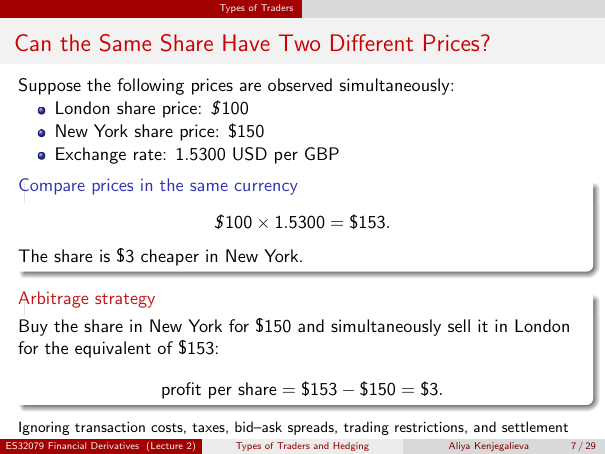

# Lecture 2 — physical page 7: Can the Same Share Have Two Different Prices?

**Authored normalized source transcription — needs independent review.** Typography, line breaks, table structure and mathematical notation are normalized; this is not a word-for-word facsimile or a tutorial lesson. Source-label caveats and notation/assumption clarifications are explicitly labelled. The linked original image and unchanged raw extraction remain the evidence.

[Raw page extraction](../../extracted/lecture-2/page-007.md) · [Original full-page image](../../assets/lecture-2/page-007.png)

## Cross market quotes

**Source region:** upper simultaneous-price list. **Classification:** substantive.

Suppose these prices are observed simultaneously:
- London share price: **$100** (the dollar sign is printed in the original image).
- New York share price: **$150**.
- Exchange rate: **1.5300 USD per GBP**.

**Source-label caveat (author annotation):** the London quote's printed dollar sign conflicts with the subsequent GBP-to-USD conversion. It is not merely a raw-extraction error. The source's displayed GBP-to-USD conversion, $3 spread and buy-New-York conclusion do not follow from the literal dollar labels. This caveat does not rule out an opposite-direction gross arbitrage if both printed dollar prices are interpreted as USD under frictionless assumptions; it is not a corrected official solution.

## Currency conversion

**Source region:** middle compare-prices box. **Classification:** substantive.

The printed comparison is

$$\$100\times1.5300=\$153.$$

The source says the share is $3 cheaper in New York.

**Conditional clarification, not a PDF correction:** the conversion and conclusion are dimensionally consistent only if the London quote is **£100**, so £100 × 1.5300 USD/GBP = $153. That intended-GBP interpretation is an explicit assumption; the original dollar label is retained above.

## Arbitrage trade

**Source region:** lower arbitrage-strategy box. **Classification:** substantive.

The source strategy is to buy the share in New York for $150 and simultaneously sell it in London for the equivalent of $153:

$$\text{profit per share}=\$153-\$150=\$3.$$

The numerical profit is conditional on the intended **£100 London quote** clarification, not a result established by the inconsistent literal dollar labels alone.

**Source idealisations retained within this trade span:** the footnote reads, “Ignoring transaction costs, taxes, bid–ask spreads, trading restrictions, and settlement”. The visible line ends at **settlement**; no continuation is invented. The displayed $3 is a gross difference under these idealisations, not a claim of net profit after costs.

## Arbitrage assumptions

**Source region:** small line immediately above footer. **Classification:** substantive.

The source footnote reads: “Ignoring transaction costs, taxes, bid–ask spreads, trading restrictions, and settlement”. It visibly ends at **settlement**; no missing continuation is invented. These idealisations accompany the displayed arbitrage example.

**Authored source caution — not original slide content:** The original image itself prints London $100 despite the USD/GBP conversion. The shown conversion and $3 arbitrage are conditional on the intended £100 London quote; they do not follow from the inconsistent literal dollar labels alone.

## Page frame

**Source region:** title/header/footer frame. **Classification:** administrative.

Page title: “Can the Same Share Have Two Different Prices?”. Printed footer: ES32079 Financial Derivatives (Lecture 2); Types of Traders and Hedging; Aliya Kenjegalieva; **7 / 29**. Physical PDF page 7 and printed counter agree. The footer is administrative source metadata, not a separate technical claim.

