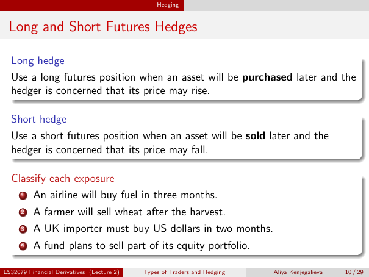

# Lecture 2 — physical page 10: Long and Short Futures Hedges

**Authored normalized source transcription — needs independent review.** Typography, line breaks, table structure and mathematical notation are normalized; this is not a word-for-word facsimile or a tutorial lesson. Source-label caveats and notation/assumption clarifications are explicitly labelled. The linked original image and unchanged raw extraction remain the evidence.

[Raw page extraction](../../extracted/lecture-2/page-010.md) · [Original full-page image](../../assets/lecture-2/page-010.png)

## Long hedge

**Source region:** upper long-hedge box. **Classification:** substantive.

Use a long futures position when an asset will be **purchased** later and the hedger is concerned that its price may **rise**.

## Short hedge

**Source region:** middle short-hedge box. **Classification:** substantive.

Use a short futures position when an asset will be **sold** later and the hedger is concerned that its price may **fall**.

## Hedge direction exposures

**Source region:** lower classify-each-exposure box. **Classification:** substantive.

Classify:
1. An airline will buy fuel in three months.
2. A farmer will sell wheat after the harvest.
3. A UK importer must buy US dollars in two months.
4. A fund plans to sell part of its equity portfolio.

## Page frame

**Source region:** title/header/footer frame. **Classification:** administrative.

Page title: “Long and Short Futures Hedges”. Printed footer: ES32079 Financial Derivatives (Lecture 2); Types of Traders and Hedging; Aliya Kenjegalieva; **10 / 29**. Physical PDF page 10 and printed counter agree. The footer is administrative source metadata, not a separate technical claim.

