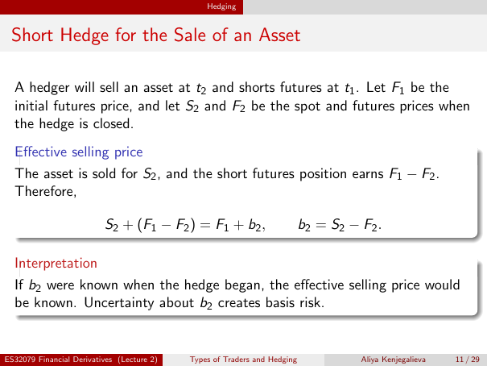

# Lecture 2 — physical page 11: Short Hedge for the Sale of an Asset

**Authored normalized source transcription — needs independent review.** Typography, line breaks, table structure and mathematical notation are normalized; this is not a word-for-word facsimile or a tutorial lesson. Source-label caveats and notation/assumption clarifications are explicitly labelled. The linked original image and unchanged raw extraction remain the evidence.

[Raw page extraction](../../extracted/lecture-2/page-011.md) · [Original full-page image](../../assets/lecture-2/page-011.png)

## Short hedge setup

**Source region:** upper notation and hedge timing. **Classification:** substantive.

A hedger will sell an asset at $t_2$ and shorts futures at $t_1$. $F_1$ is the initial futures price; $S_2$ and $F_2$ are the spot and futures prices when the hedge is closed.

## Short hedge derivation

**Source region:** middle effective-selling-price box. **Classification:** substantive.

The asset is sold for $S_2$, and the short futures position earns $F_1-F_2$. Therefore,

$$S_2+(F_1-F_2)=F_1+b_2,\qquad b_2=S_2-F_2.$$

These are effective prices and futures gains **per unit**, with matching quotation units. $b_2$ is the closing basis; the $F_1-F_2$ sign is for the **short** futures position.

## Basis uncertainty

**Source region:** lower interpretation box. **Classification:** substantive.

If $b_2$ were known when the hedge began, the effective selling price would be known. Uncertainty about $b_2$ creates basis risk.

## Page frame

**Source region:** title/header/footer frame. **Classification:** administrative.

Page title: “Short Hedge for the Sale of an Asset”. Printed footer: ES32079 Financial Derivatives (Lecture 2); Types of Traders and Hedging; Aliya Kenjegalieva; **11 / 29**. Physical PDF page 11 and printed counter agree. The footer is administrative source metadata, not a separate technical claim.

