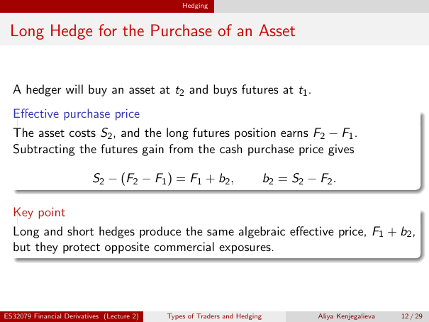

# Lecture 2 — physical page 12: Long Hedge for the Purchase of an Asset

**Authored normalized source transcription — needs independent review.** Typography, line breaks, table structure and mathematical notation are normalized; this is not a word-for-word facsimile or a tutorial lesson. Source-label caveats and notation/assumption clarifications are explicitly labelled. The linked original image and unchanged raw extraction remain the evidence.

[Raw page extraction](../../extracted/lecture-2/page-012.md) · [Original full-page image](../../assets/lecture-2/page-012.png)

## Long hedge setup

**Source region:** upper hedge timing statement. **Classification:** substantive.

A hedger will buy an asset at $t_2$ and buys futures at $t_1$.

## Long hedge derivation

**Source region:** middle effective-purchase-price box. **Classification:** substantive.

The asset costs $S_2$, and the long futures position earns $F_2-F_1$. Subtract the futures gain from the cash purchase price:

$$S_2-(F_2-F_1)=F_1+b_2,\qquad b_2=S_2-F_2.$$

$F_1$ is the initial futures price, $S_2,F_2$ the closing spot/futures prices, and $b_2$ the closing basis. The outer subtraction applies to the **entire** long gain $F_2-F_1$.

## Same effective price

**Source region:** lower key-point box. **Classification:** substantive.

Long and short hedges produce the same algebraic effective price, $F_1+b_2$, but they protect opposite commercial exposures.

## Page frame

**Source region:** title/header/footer frame. **Classification:** administrative.

Page title: “Long Hedge for the Purchase of an Asset”. Printed footer: ES32079 Financial Derivatives (Lecture 2); Types of Traders and Hedging; Aliya Kenjegalieva; **12 / 29**. Physical PDF page 12 and printed counter agree. The footer is administrative source metadata, not a separate technical claim.

