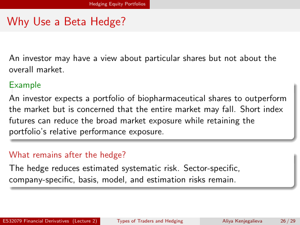

# Lecture 2 — physical page 26: Why Use a Beta Hedge?

**Authored normalized source transcription — needs independent review.** Typography, line breaks, table structure and mathematical notation are normalized; this is not a word-for-word facsimile or a tutorial lesson. Source-label caveats and notation/assumption clarifications are explicitly labelled. The linked original image and unchanged raw extraction remain the evidence.

[Raw page extraction](../../extracted/lecture-2/page-026.md) · [Original full-page image](../../assets/lecture-2/page-026.png)

## Relative view

**Source region:** upper motivation statement. **Classification:** substantive.

An investor may have a view about particular shares but not about the overall market.

## Biopharma example

**Source region:** middle example box. **Classification:** substantive.

An investor expects a portfolio of **biopharmaceutical shares** to outperform the market but is concerned the entire market may fall. Short index futures can reduce broad market exposure while retaining the portfolio's **relative performance exposure**.

## Beta residual risks

**Source region:** lower what-remains box. **Classification:** substantive.

The hedge reduces estimated systematic risk. **Sector-specific, company-specific, basis, model, and estimation risks remain.**

## Page frame

**Source region:** title/header/footer frame. **Classification:** administrative.

Page title: “Why Use a Beta Hedge?”. Printed footer: ES32079 Financial Derivatives (Lecture 2); Types of Traders and Hedging; Aliya Kenjegalieva; **26 / 29**. Physical PDF page 26 and printed counter agree. The footer is administrative source metadata, not a separate technical claim.

