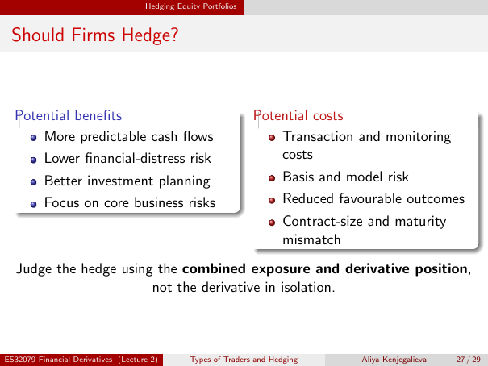

# Lecture 2 — physical page 27: Should Firms Hedge?

**Authored normalized source transcription — needs independent review.** Typography, line breaks, table structure and mathematical notation are normalized; this is not a word-for-word facsimile or a tutorial lesson. Source-label caveats and notation/assumption clarifications are explicitly labelled. The linked original image and unchanged raw extraction remain the evidence.

[Raw page extraction](../../extracted/lecture-2/page-027.md) · [Original full-page image](../../assets/lecture-2/page-027.png)

## Hedging benefits

**Source region:** left potential-benefits box. **Classification:** substantive.

Potential benefits:
- More predictable cash flows.
- Lower financial-distress risk.
- Better investment planning.
- Focus on core business risks.

## Hedging costs

**Source region:** right potential-costs box. **Classification:** substantive.

Potential costs:
- Transaction and monitoring costs.
- Basis and model risk.
- Reduced favourable outcomes.
- Contract-size and maturity mismatch.

## Combined exposure principle

**Source region:** lower bold evaluation sentence. **Classification:** substantive.

Judge the hedge using the **combined exposure and derivative position**, not the derivative in isolation.

## Page frame

**Source region:** title/header/footer frame. **Classification:** administrative.

Page title: “Should Firms Hedge?”. Printed footer: ES32079 Financial Derivatives (Lecture 2); Types of Traders and Hedging; Aliya Kenjegalieva; **27 / 29**. Physical PDF page 27 and printed counter agree. The footer is administrative source metadata, not a separate technical claim.

