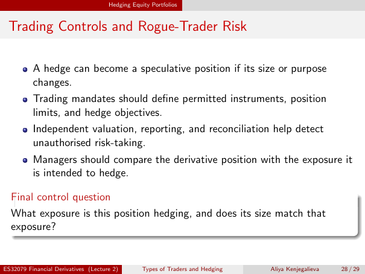

# Lecture 2 — physical page 28: Trading Controls and Rogue-Trader Risk

**Authored normalized source transcription — needs independent review.** Typography, line breaks, table structure and mathematical notation are normalized; this is not a word-for-word facsimile or a tutorial lesson. Source-label caveats and notation/assumption clarifications are explicitly labelled. The linked original image and unchanged raw extraction remain the evidence.

[Raw page extraction](../../extracted/lecture-2/page-028.md) · [Original full-page image](../../assets/lecture-2/page-028.png)

## Hedge becomes speculation

**Source region:** upper first bullet. **Classification:** substantive.

A hedge can become a speculative position if its size or purpose changes.

## Trading mandates

**Source region:** upper-middle second bullet. **Classification:** substantive.

Trading mandates should define permitted instruments, position limits, and hedge objectives.

## Independent controls

**Source region:** middle third bullet. **Classification:** substantive.

Independent valuation, reporting, and reconciliation help detect unauthorised risk-taking.

## Exposure comparison

**Source region:** middle-lower fourth bullet. **Classification:** substantive.

Managers should compare the derivative position with the exposure it is intended to hedge.

## Control question

**Source region:** lower final-control-question box. **Classification:** substantive.

What exposure is this position hedging, and does its size match that exposure?

## Page frame

**Source region:** title/header/footer frame. **Classification:** administrative.

Page title: “Trading Controls and Rogue-Trader Risk”. Printed footer: ES32079 Financial Derivatives (Lecture 2); Types of Traders and Hedging; Aliya Kenjegalieva; **28 / 29**. Physical PDF page 28 and printed counter agree. The footer is administrative source metadata, not a separate technical claim.

