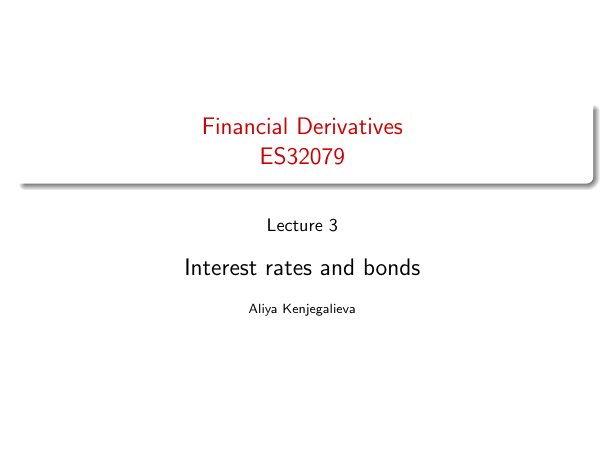

# Interest rates and bonds

Source: lecture-3; physical PDF page 1 of 41. No printed page/slide number on title page.

**Authored normalized transcription — needs independent review.** Typography, line wrapping and mathematical encoding are normalized; this is not unchanged raw extraction. Labelled corrections/qualifications are not original source text.

[Unchanged raw layout extraction](../../extracted/lecture-3/page-001.md#page-1)

## Title

Financial Derivatives, ES32079. Lecture 3: Interest rates and bonds. Aliya Kenjegalieva.

