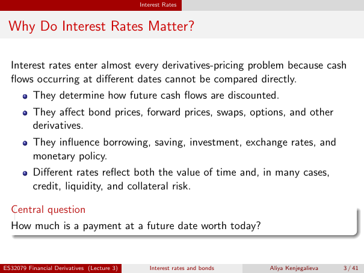

# Why Do Interest Rates Matter?

Source: lecture-3; physical PDF page 3 of 41. Printed page/slide label: 3 / 41.

**Authored normalized transcription — needs independent review.** Typography, line wrapping and mathematical encoding are normalized; this is not unchanged raw extraction. Labelled corrections/qualifications are not original source text.

[Unchanged raw layout extraction](../../extracted/lecture-3/page-003.md#page-3)

## Dated cashflows

Interest rates enter almost every derivatives-pricing problem because cash flows occurring at different dates cannot be compared directly.
- They determine how future cash flows are discounted.
- They affect bond prices, forward prices, swaps, options, and other derivatives.
- They influence borrowing, saving, investment, exchange rates, and monetary policy.
- Different rates reflect both the value of time and, in many cases, credit, liquidity, and collateral risk.

**Evidence locator:** lecture-3, physical PDF page 3 of 41; printed slide 3 / 41; region: Main introductory paragraph and bullet list. This is normalized source transcription, pending independent review.

[Unchanged raw layout extraction](../../extracted/lecture-3/page-003.md#page-3)

## Central question

How much is a payment at a future date worth today?

**Evidence locator:** lecture-3, physical PDF page 3 of 41; printed slide 3 / 41; region: Lower central-question box. This is normalized source transcription, pending independent review.

[Unchanged raw layout extraction](../../extracted/lecture-3/page-003.md#page-3)

## Page furniture (administrative)

Top section strip: Interest Rates.

Footer: ES32079 Financial Derivatives (Lecture 3); Interest rates and bonds; Aliya Kenjegalieva; 3 / 41.
