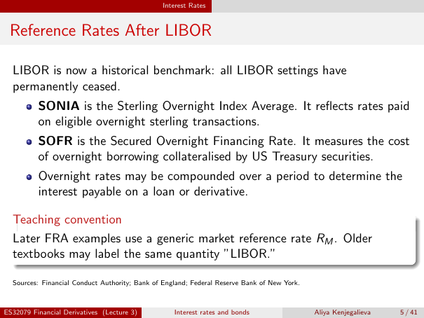

# Reference Rates After LIBOR

Source: lecture-3; physical PDF page 5 of 41. Printed page/slide label: 5 / 41.

**Authored normalized transcription — needs independent review.** Typography, line wrapping and mathematical encoding are normalized; this is not unchanged raw extraction. Labelled corrections/qualifications are not original source text.

[Unchanged raw layout extraction](../../extracted/lecture-3/page-005.md#page-5)

## Libor status

LIBOR is now a historical benchmark: all LIBOR settings have permanently ceased.

**Evidence locator:** lecture-3, physical PDF page 5 of 41; printed slide 5 / 41; region: Opening paragraph. This is normalized source transcription, pending independent review.

[Unchanged raw layout extraction](../../extracted/lecture-3/page-005.md#page-5)

## Sonia

SONIA is the Sterling Overnight Index Average. It reflects rates paid on eligible overnight sterling transactions.

**Evidence locator:** lecture-3, physical PDF page 5 of 41; printed slide 5 / 41; region: First bullet. This is normalized source transcription, pending independent review.

[Unchanged raw layout extraction](../../extracted/lecture-3/page-005.md#page-5)

## Sofr

SOFR is the Secured Overnight Financing Rate. It measures the cost of overnight borrowing collateralised by US Treasury securities.

**Evidence locator:** lecture-3, physical PDF page 5 of 41; printed slide 5 / 41; region: Second bullet. This is normalized source transcription, pending independent review.

[Unchanged raw layout extraction](../../extracted/lecture-3/page-005.md#page-5)

## Overnight compounding

Overnight rates may be compounded over a period to determine the interest payable on a loan or derivative.

**Evidence locator:** lecture-3, physical PDF page 5 of 41; printed slide 5 / 41; region: Third bullet. This is normalized source transcription, pending independent review.

[Unchanged raw layout extraction](../../extracted/lecture-3/page-005.md#page-5)

## Fra convention

Later FRA examples use a generic market reference rate $R_M$. Older textbooks may label the same quantity “LIBOR.”

Source attribution printed on slide: Financial Conduct Authority; Bank of England; Federal Reserve Bank of New York. **Editorial scope note — not original slide text:** this annotation preserves the slide's dated statements; it is not a fresh verification of current benchmark policy.

**Evidence locator:** lecture-3, physical PDF page 5 of 41; printed slide 5 / 41; region: Lower teaching-convention box. This is normalized source transcription, pending independent review.

[Unchanged raw layout extraction](../../extracted/lecture-3/page-005.md#page-5)

## Page furniture (administrative)

Top section strip: Interest Rates.

Footer: ES32079 Financial Derivatives (Lecture 3); Interest rates and bonds; Aliya Kenjegalieva; 5 / 41.
