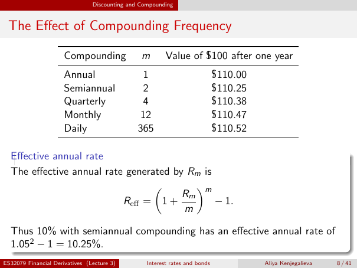

# The Effect of Compounding Frequency

Source: lecture-3; physical PDF page 8 of 41. Printed page/slide label: 8 / 41.

**Authored normalized transcription — needs independent review.** Typography, line wrapping and mathematical encoding are normalized; this is not unchanged raw extraction. Labelled corrections/qualifications are not original source text.

[Unchanged raw layout extraction](../../extracted/lecture-3/page-008.md#page-8)

## Frequency table

Value of $100 after one year (the 10% nominal annual-rate example):

| Compounding | $m$ | Value |
|---|---:|---:|
| Annual | 1 | $110.00 |
| Semiannual | 2 | $110.25 |
| Quarterly | 4 | $110.38 |
| Monthly | 12 | $110.47 |
| Daily | 365 | $110.52 |

**Evidence locator:** lecture-3, physical PDF page 8 of 41; printed slide 8 / 41; region: Upper table. This is normalized source transcription, pending independent review.

[Unchanged raw layout extraction](../../extracted/lecture-3/page-008.md#page-8)

## Effective annual rate

The effective annual rate generated by $R_m$ is
$$R_{\mathrm{eff}}=\left(1+\frac{R_m}{m}\right)^m-1.$$

**Evidence locator:** lecture-3, physical PDF page 8 of 41; printed slide 8 / 41; region: Lower definition and equation. This is normalized source transcription, pending independent review.

[Unchanged raw layout extraction](../../extracted/lecture-3/page-008.md#page-8)

## Effective example

Thus 10% with semiannual compounding has an effective annual rate of $1.05^2-1=10.25\%$.

**Evidence locator:** lecture-3, physical PDF page 8 of 41; printed slide 8 / 41; region: Last sentence. This is normalized source transcription, pending independent review.

[Unchanged raw layout extraction](../../extracted/lecture-3/page-008.md#page-8)

## Page furniture (administrative)

Top section strip: Discounting and Compounding.

Footer: ES32079 Financial Derivatives (Lecture 3); Interest rates and bonds; Aliya Kenjegalieva; 8 / 41.
