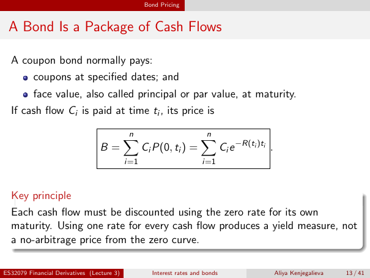

# A Bond Is a Package of Cash Flows

Source: lecture-3; physical PDF page 13 of 41. Printed page/slide label: 13 / 41.

**Authored normalized transcription — needs independent review.** Typography, line wrapping and mathematical encoding are normalized; this is not unchanged raw extraction. Labelled corrections/qualifications are not original source text.

[Unchanged raw layout extraction](../../extracted/lecture-3/page-013.md#page-13)

## Coupon principal

A coupon bond normally pays coupons at specified dates, and face value, also called principal or par value, at maturity.

**Evidence locator:** lecture-3, physical PDF page 13 of 41; printed slide 13 / 41; region: Upper text and bullets. This is normalized source transcription, pending independent review.

[Unchanged raw layout extraction](../../extracted/lecture-3/page-013.md#page-13)

## Bond pricing sum

If cash flow $C_i$ is paid at time $t_i$, its price is
$$B=\sum_{i=1}^{n}C_iP(0,t_i)=\sum_{i=1}^{n}C_i e^{-R(t_i)t_i}.$$

**Evidence locator:** lecture-3, physical PDF page 13 of 41; printed slide 13 / 41; region: Middle boxed equation. This is normalized source transcription, pending independent review.

[Unchanged raw layout extraction](../../extracted/lecture-3/page-013.md#page-13)

## Own maturity discounting

Each cash flow must be discounted using the zero rate for its own maturity. Using one rate for every cash flow produces a yield measure, not a no-arbitrage price from the zero curve.

**Evidence locator:** lecture-3, physical PDF page 13 of 41; printed slide 13 / 41; region: Lower key-principle box. This is normalized source transcription, pending independent review.

[Unchanged raw layout extraction](../../extracted/lecture-3/page-013.md#page-13)

## Page furniture (administrative)

Top section strip: Bond Pricing.

Footer: ES32079 Financial Derivatives (Lecture 3); Interest rates and bonds; Aliya Kenjegalieva; 13 / 41.
