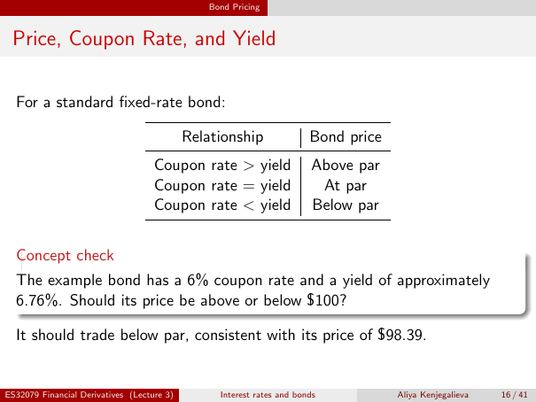

# Price, Coupon Rate, and Yield

Source: lecture-3; physical PDF page 16 of 41. Printed page/slide label: 16 / 41.

**Authored normalized transcription — needs independent review.** Typography, line wrapping and mathematical encoding are normalized; this is not unchanged raw extraction. Labelled corrections/qualifications are not original source text.

[Unchanged raw layout extraction](../../extracted/lecture-3/page-016.md#page-16)

## Printed coupon yield table

For a standard fixed-rate bond, the source prints:

| Relationship | Bond price |
|---|---|
| Coupon rate > yield | Above par |
| Coupon rate = yield | At par |
| Coupon rate < yield | Below par |

**Rate-convention qualification — authored, not original slide text:** the coupon-versus-yield par rule requires matched coupon/payment and yield compounding conventions. Here the 6% coupon is nominal annual paid semiannually, but the preceding approximately 6.76% yield is continuously compounded. Equality between such unmatched quoted numbers would not establish par. The source example’s below-par conclusion remains valid.

**Evidence locator:** lecture-3, physical PDF page 16 of 41; printed slide 16 / 41; region: Upper table. This is normalized source transcription, pending independent review.

[Unchanged raw layout extraction](../../extracted/lecture-3/page-016.md#page-16)

## Concept check

The example bond has a 6% coupon rate and a yield of approximately 6.76%. Should its price be above or below $100?

Source answer: it should trade below par, consistent with its price of $98.39.

**Rate-convention qualification — authored, not original slide text:** the coupon-versus-yield par rule requires matched coupon/payment and yield compounding conventions. Here the 6% coupon is nominal annual paid semiannually, but the preceding approximately 6.76% yield is continuously compounded. Equality between such unmatched quoted numbers would not establish par. The source example’s below-par conclusion remains valid.

**Evidence locator:** lecture-3, physical PDF page 16 of 41; printed slide 16 / 41; region: Lower question and supplied answer. This is normalized source transcription, pending independent review.

[Unchanged raw layout extraction](../../extracted/lecture-3/page-016.md#page-16)

## Rate convention caution

**Qualification — not original slide text:** the coupon-versus-yield par rule requires matched coupon/payment and yield compounding conventions. The preceding yield is continuously compounded, while the 6% coupon is nominal annual paid semiannually. Equality between those unmatched quoted numbers does not establish par. The numerical below-par conclusion here remains valid.

## Page furniture (administrative)

Top section strip: Bond Pricing.

Footer: ES32079 Financial Derivatives (Lecture 3); Interest rates and bonds; Aliya Kenjegalieva; 16 / 41.
