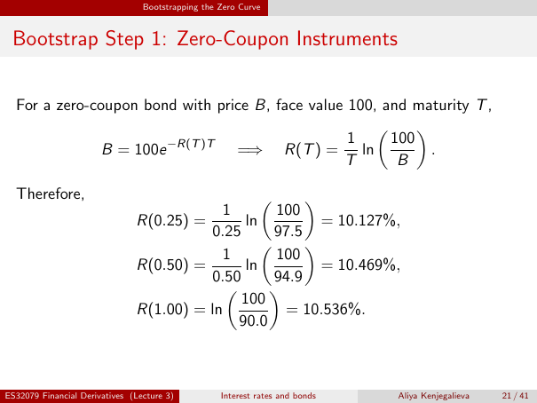

# Bootstrap Step 1: Zero-Coupon Instruments

Source: lecture-3; physical PDF page 21 of 41. Printed page/slide label: 21 / 41.

**Authored normalized transcription — needs independent review.** Typography, line wrapping and mathematical encoding are normalized; this is not unchanged raw extraction. Labelled corrections/qualifications are not original source text.

[Unchanged raw layout extraction](../../extracted/lecture-3/page-021.md#page-21)

## Zero rate inversion

For a zero-coupon bond with price $B$, face value 100, and maturity $T$,
$$B=100e^{-R(T)T}\implies R(T)=\frac1T\ln\left(\frac{100}{B}\right).$$

**Evidence locator:** lecture-3, physical PDF page 21 of 41; printed slide 21 / 41; region: Upper equation. This is normalized source transcription, pending independent review.

[Unchanged raw layout extraction](../../extracted/lecture-3/page-021.md#page-21)

## First three rates

Therefore,
$$R(0.25)=\frac1{0.25}\ln\left(\frac{100}{97.5}\right)=10.127\%,$$
$$R(0.50)=\frac1{0.50}\ln\left(\frac{100}{94.9}\right)=10.469\%,$$
$$R(1.00)=\ln\left(\frac{100}{90.0}\right)=10.536\%.$$

**Evidence locator:** lecture-3, physical PDF page 21 of 41; printed slide 21 / 41; region: Lower three calculations. This is normalized source transcription, pending independent review.

[Unchanged raw layout extraction](../../extracted/lecture-3/page-021.md#page-21)

## Page furniture (administrative)

Top section strip: Bootstrapping the Zero Curve.

Footer: ES32079 Financial Derivatives (Lecture 3); Interest rates and bonds; Aliya Kenjegalieva; 21 / 41.
