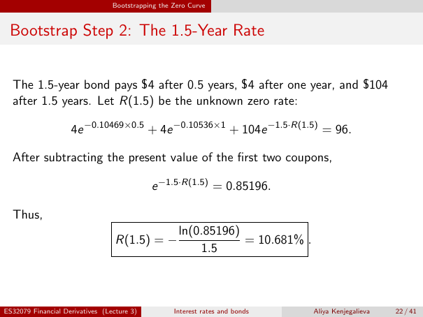

# Bootstrap Step 2: The 1.5-Year Rate

Source: lecture-3; physical PDF page 22 of 41. Printed page/slide label: 22 / 41.

**Authored normalized transcription — needs independent review.** Typography, line wrapping and mathematical encoding are normalized; this is not unchanged raw extraction. Labelled corrections/qualifications are not original source text.

[Unchanged raw layout extraction](../../extracted/lecture-3/page-022.md#page-22)

## One point five cashflows

The 1.5-year bond pays $4 after 0.5 years, $4 after one year, and $104 after 1.5 years. Let $R(1.5)$ be the unknown zero rate:
$$4e^{-0.10469\times0.5}+4e^{-0.10536\times1}+104e^{-1.5R(1.5)}=96.$$

**Evidence locator:** lecture-3, physical PDF page 22 of 41; printed slide 22 / 41; region: Upper cash-flow statement and equation. This is normalized source transcription, pending independent review.

[Unchanged raw layout extraction](../../extracted/lecture-3/page-022.md#page-22)

## One point five solution

After subtracting the present value of the first two coupons,
$$e^{-1.5R(1.5)}=0.85196.$$
Thus,
$$R(1.5)=-\frac{\ln(0.85196)}{1.5}=10.681\%.$$

**Evidence locator:** lecture-3, physical PDF page 22 of 41; printed slide 22 / 41; region: Lower rearrangement and answer. This is normalized source transcription, pending independent review.

[Unchanged raw layout extraction](../../extracted/lecture-3/page-022.md#page-22)

## Page furniture (administrative)

Top section strip: Bootstrapping the Zero Curve.

Footer: ES32079 Financial Derivatives (Lecture 3); Interest rates and bonds; Aliya Kenjegalieva; 22 / 41.
