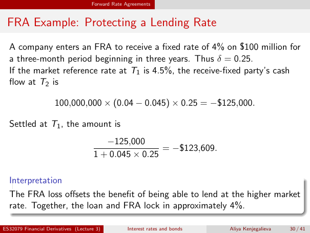

# FRA Example: Protecting a Lending Rate

Source: lecture-3; physical PDF page 30 of 41. Printed page/slide label: 30 / 41.

**Authored normalized transcription — needs independent review.** Typography, line wrapping and mathematical encoding are normalized; this is not unchanged raw extraction. Labelled corrections/qualifications are not original source text.

[Unchanged raw layout extraction](../../extracted/lecture-3/page-030.md#page-30)

## Fra example terminal

A company enters an FRA to receive a fixed rate of 4% on $100 million for a three-month period beginning in three years. Thus $\delta=0.25$. If the market reference rate at $T_1$ is 4.5%, the receive-fixed party's cash flow at $T_2$ is
$$100{,}000{,}000(0.04-0.045)0.25=-\$125{,}000.$$

**Evidence locator:** lecture-3, physical PDF page 30 of 41; printed slide 30 / 41; region: Upper data and terminal calculation. This is normalized source transcription, pending independent review.

[Unchanged raw layout extraction](../../extracted/lecture-3/page-030.md#page-30)

## Fra example settlement

Settled at $T_1$, the amount is
$$\frac{-125{,}000}{1+0.045\times0.25}=-\$123{,}609.$$

**Evidence locator:** lecture-3, physical PDF page 30 of 41; printed slide 30 / 41; region: Middle settlement fraction. This is normalized source transcription, pending independent review.

[Unchanged raw layout extraction](../../extracted/lecture-3/page-030.md#page-30)

## Fra example interpretation

The FRA loss offsets the benefit of being able to lend at the higher market rate. Together, the loan and FRA lock in approximately 4%.

**Evidence locator:** lecture-3, physical PDF page 30 of 41; printed slide 30 / 41; region: Lower interpretation box. This is normalized source transcription, pending independent review.

[Unchanged raw layout extraction](../../extracted/lecture-3/page-030.md#page-30)

## Page furniture (administrative)

Top section strip: Forward Rate Agreements.

Footer: ES32079 Financial Derivatives (Lecture 3); Interest rates and bonds; Aliya Kenjegalieva; 30 / 41.
